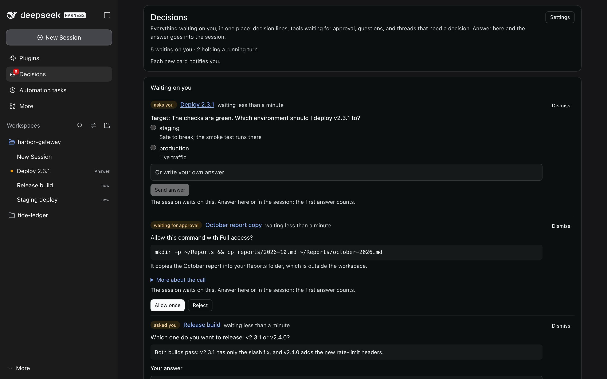
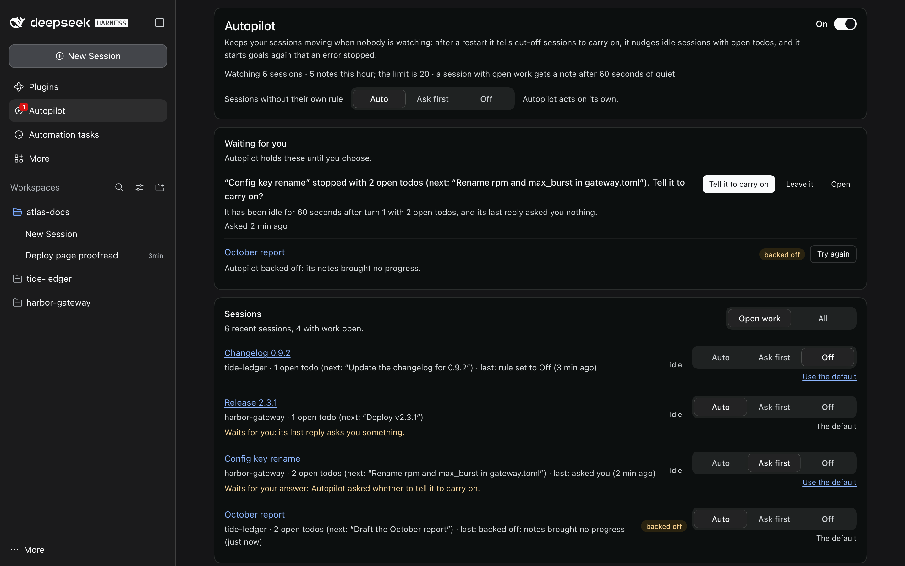
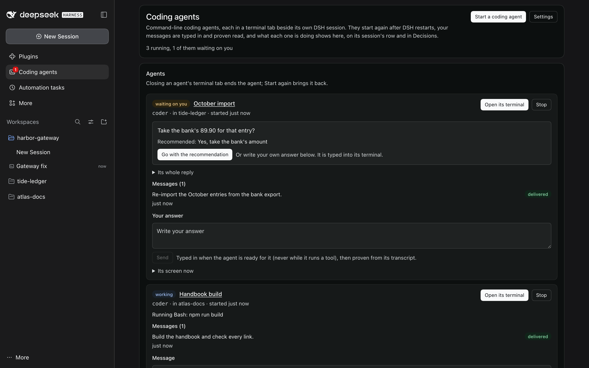
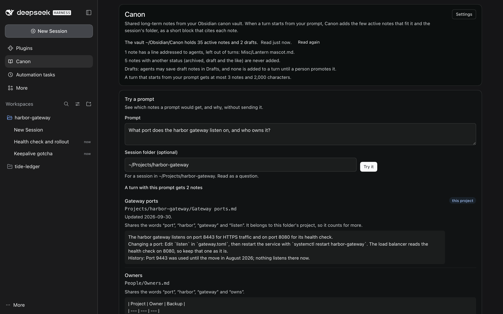
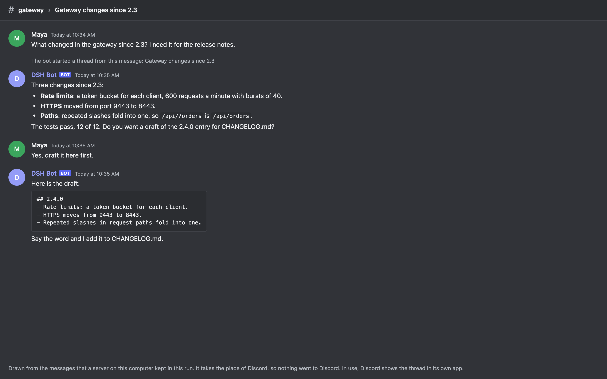
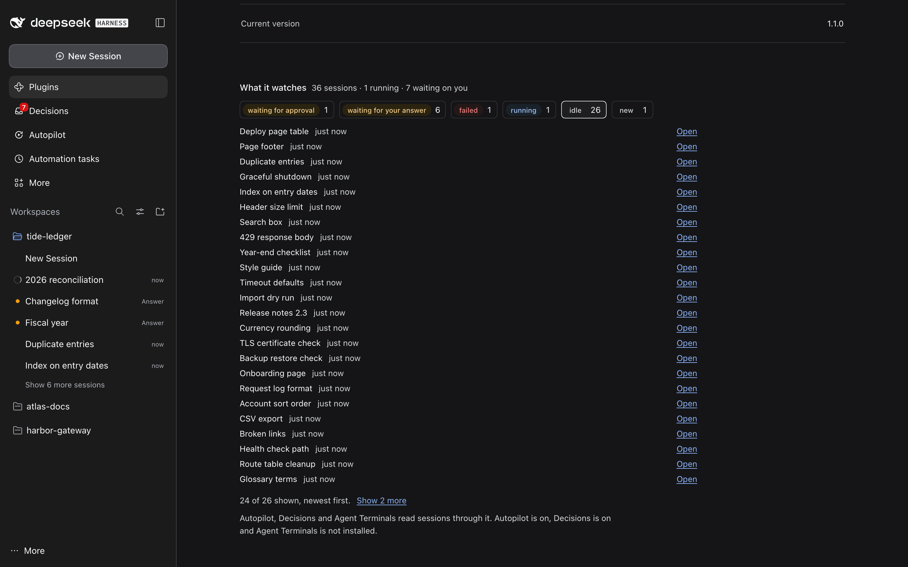
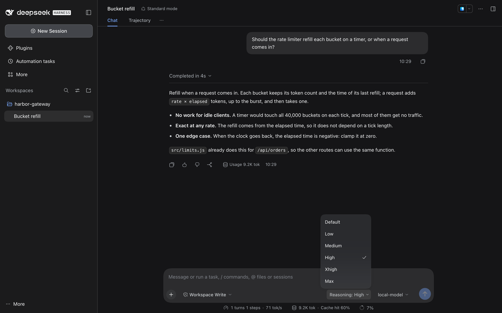
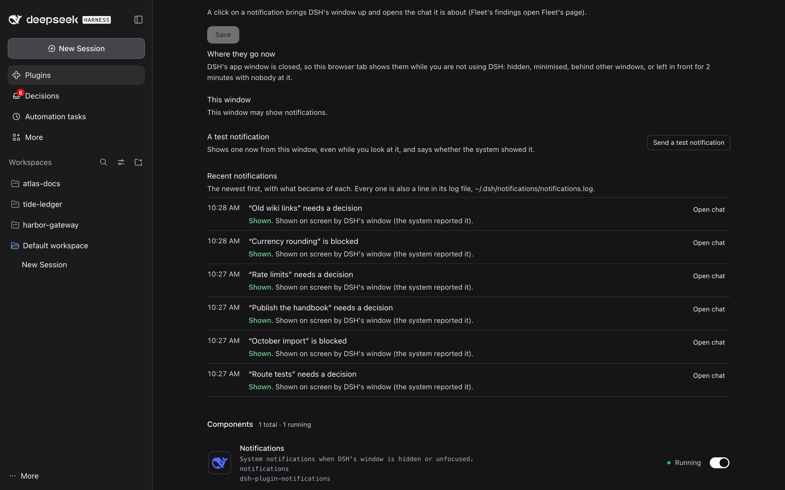
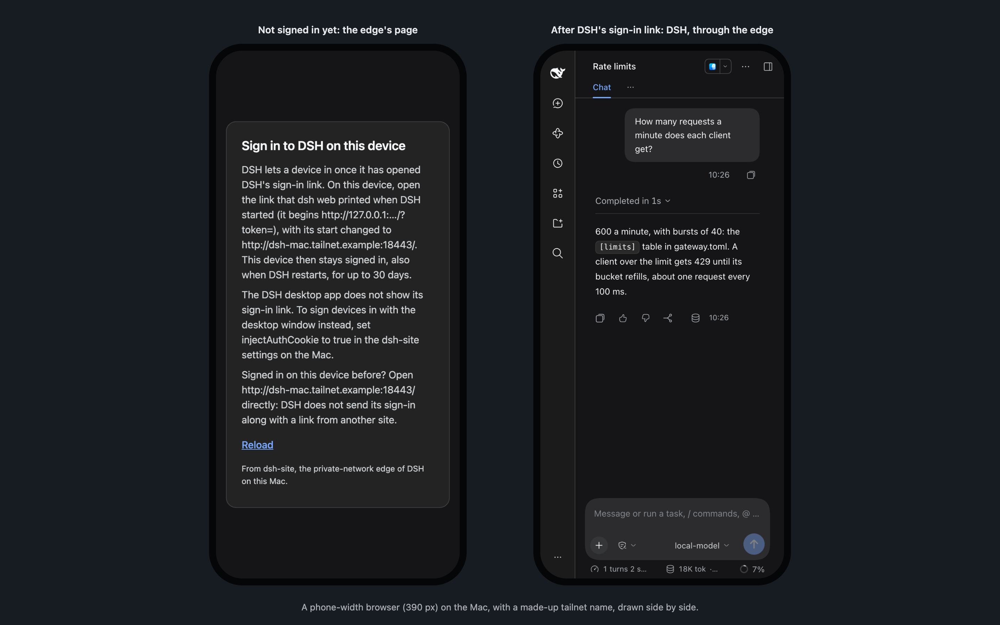
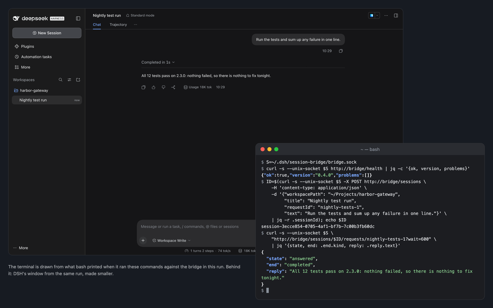

# dsh-public-plugins

Community plugins for [DeepSeek Harness](https://github.com/deepseek-ai/deepseek-harness) (DSH) Desktop.

Each plugin is a normal DSH plugin package. You add it to a DSH profile's bundles and set it up in the profile's `cordis.patch.yml`. Setup changes apply without a restart when the profile uses `patchReload: live`.

| Plugin | What it does |
| --- | --- |
| [`dsh-site`](plugins/dsh-site) | Serves the running DSH Desktop GUI to other devices on a private network (for example a Tailscale tailnet). Same sessions, same workspaces, same tools as the machine itself. |
| [`discord`](plugins/discord) | Connects a Discord bot to DSH sessions. Each Discord thread is one persistent agent session, and the agent answers through Discord tools. Full bot setup steps are in its README. |
| [`categories`](plugins/categories) | Categories of workspaces in DSH's session list: a header per category over its workspaces, Other workspaces for the rest, made and arranged from the list or the Categories page. |
| [`coordinator`](plugins/coordinator) | Any chat can run its work in threads. The chat starts thread sessions for focused work, each thread reports back to it, and threads keep their own model, effort and permission. |
| [`calendar`](plugins/calendar) | Your calendars, for you and your agents: iCloud, Google, Microsoft 365 and Exchange Online, Fastmail, Nextcloud and other CalDAV servers, subscribed `.ics` feeds, and calendars on this computer. Agents read them and, as their permission allows, change them. |
| [`session-bridge`](plugins/session-bridge) | A local JSON API on a Unix socket that drives the Host's own session controller. Scripts and other agents can create, prompt, steer, cancel and read DSH sessions, and you watch them live in the DSH window. |
| [`session-watch`](plugins/session-watch) | The shared watcher behind Autopilot, Decisions and Agent Terminals: every session's state from DSH's own events, and delivery of a message proven by the session's own log. No page of its own. |
| [`autopilot`](plugins/autopilot) | Keeps sessions moving when nobody is watching: after a restart it tells cut-off sessions to carry on, nudges quiet sessions with open todos once and backs off, and restarts goals an error stopped. Every action has a Why line and a kill switch. |
| [`decisions`](plugins/decisions) | One inbox for everything waiting on you: decision lines, tools waiting for approval, questions in the question box, threads that need a decision. Each card shows the question, the recommendation, the session and the wait; an answer goes into the session, proven by its log. Optional note to a webhook or a command. |
| [`agent-terminals`](plugins/agent-terminals) | Command-line coding agents as part of DSH: each in a terminal tab beside its own session, started again after a restart and resuming its conversation, with your messages typed in one at a time and proven read from its transcript, and what it is doing (working, idle, waiting on you) on its session's row and in Decisions. |
| [`proof`](plugins/proof) | Checks every claim of done, passed, fixed or deployed against what its turn ran, flags the ones nothing shows, and keeps a ledger you can export. An independent read-only check on a local model, when you want one. |
| [`canon`](plugins/canon) | Shared long-term memory: before a turn, the few active notes of your canon vault (an Obsidian folder) that fit the session's folder and prompt, as one short block that names each note's path. Reads the vault only, unless you allow draft notes; only you can promote a draft. |
| [`recall`](plugins/recall) | Searches everything already done: a local full-text index of DSH sessions, transcript folders and handoff notes, with filters by folder, model, date and kind. A result opens its session at that exact turn, and agents search the same index with the `recall_search` tool. |
| [`wallpaper`](plugins/wallpaper) | Wallpaper and glass for DSH Desktop: a wallpaper library with rotation and colours, frosted glass on the sidebar, conversation, composer and right panel, motion, and an editable headline. Visual only. |
| [`reasoning-pill`](plugins/reasoning-pill) | One reasoning control: a Reasoning pill beside the model name in the composer, in place of DSH's Effort row in the model menu. |
| [`notifications`](plugins/notifications) | System notifications for DSH while you are not using it. The coordinator, Decisions, Agent Terminals and Autopilot send their news through it, a click brings DSH's window up on the chat the news is about, and its page lists what became of each one. |

Session Watch, Autopilot, Decisions, Agent Terminals, Proof, Canon and Recall make up the DSH Plugin Suite: how they fit together, how to install all of them, and how each was tested and judged are in [SUITE.md](SUITE.md).

These plugins are independent work. They are not made or endorsed by DeepSeek.

<!-- showcase:gallery -->
## Gallery

One picture of each plugin, from a demo home. Each plugin's README has more.

<table>
<tr>
<td width="50%" valign="top"><a href="plugins/coordinator"></a><br><a href="plugins/coordinator"><b>Coordinator</b></a> 0.1.0: Any chat can run its work in threads that report back to it.</td>
<td width="50%" valign="top"><a href="plugins/decisions"></a><br><a href="plugins/decisions"><b>Decisions</b></a> 1.0.1: One inbox for everything waiting on you. Answer in place.</td>
</tr>
<tr>
<td width="50%" valign="top"><a href="plugins/recall"></a><br><a href="plugins/recall"><b>Recall</b></a> 1.0.0: Search everything you already did, and open each result at its exact turn.</td>
<td width="50%" valign="top"><a href="plugins/proof"></a><br><a href="plugins/proof"><b>Proof</b></a> 1.0.0: Checks each claim of done, passed, fixed or deployed against what its turn ran.</td>
</tr>
<tr>
<td width="50%" valign="top"><a href="plugins/autopilot"></a><br><a href="plugins/autopilot"><b>Autopilot</b></a> 1.1.0: Keeps sessions moving when nobody is watching.</td>
<td width="50%" valign="top"><a href="plugins/agent-terminals"></a><br><a href="plugins/agent-terminals"><b>Agent Terminals</b></a> 1.0.0: Command-line coding agents in DSH, each in a terminal tab beside its own session.</td>
</tr>
<tr>
<td width="50%" valign="top"><a href="plugins/canon"></a><br><a href="plugins/canon"><b>Canon</b></a> 1.0.0: Shared long-term memory from an Obsidian vault, added to each turn as a short cited block.</td>
<td width="50%" valign="top"><a href="plugins/calendar"></a><br><a href="plugins/calendar"><b>Calendar</b></a> 0.1.0: Your calendars in DSH, for you and your agents.</td>
</tr>
<tr>
<td width="50%" valign="top"><a href="plugins/discord"></a><br><a href="plugins/discord"><b>Discord</b></a> 0.2.0: A Discord bot for your own channels: each conversation gets a thread and its own DSH session.</td>
<td width="50%" valign="top"><a href="plugins/session-watch"></a><br><a href="plugins/session-watch"><b>Session Watch</b></a> 1.1.0: The shared watcher behind Autopilot, Decisions and Agent Terminals.</td>
</tr>
<tr>
<td width="50%" valign="top"><a href="plugins/categories"></a><br><a href="plugins/categories"><b>Categories</b></a> 0.1.0: Group your workspaces into categories in DSH's session list.</td>
<td width="50%" valign="top"><a href="plugins/reasoning-pill"></a><br><a href="plugins/reasoning-pill"><b>Reasoning pill</b></a> 0.1.0: One place to set reasoning: a Reasoning control beside the model name.</td>
</tr>
<tr>
<td width="50%" valign="top"><a href="plugins/notifications"></a><br><a href="plugins/notifications"><b>Notifications</b></a> 0.1.0: System notifications while you are not using DSH's window.</td>
<td width="50%" valign="top"><a href="plugins/wallpaper"></a><br><a href="plugins/wallpaper"><b>Wallpaper</b></a> 0.1.0: Your wallpapers behind DSH, with frosted glass, colour mode and motion.</td>
</tr>
<tr>
<td width="50%" valign="top"><a href="plugins/dsh-site"></a><br><a href="plugins/dsh-site"><b>DSH Site</b></a> 0.2.0: Opens this Mac's DSH window to the devices on your private network.</td>
<td width="50%" valign="top"><a href="plugins/session-bridge"></a><br><a href="plugins/session-bridge"><b>Session Bridge</b></a> 0.4.0: Lets scripts and scheduled jobs on this Mac start, prompt, steer and read DSH sessions.</td>
</tr>
</table>
<!-- /showcase:gallery -->

## Install a plugin

DSH loads a plugin only when the profile lists its package in `dsh.profile.bundles`. The plugin's bundle then adds the plugin's row, and you configure that row in the profile's `cordis.patch.yml`. The examples use the default desktop profile at `~/.dsh/profiles/desktop` and the `coordinator` plugin.

| Plugin | Package | Row id |
| --- | --- | --- |
| dsh-site | `dsh-plugin-dsh-site` | `dsh-site` |
| discord | `dsh-plugin-discord` | `discord` |
| categories | `dsh-plugin-categories` | `categories` |
| coordinator | `dsh-plugin-coordinator` | `coordinator` |
| calendar | `dsh-plugin-calendar` | `calendar` |
| session-bridge | `dsh-plugin-session-bridge` | `session-bridge` |
| session-watch | `dsh-plugin-session-watch` | `session-watch` |
| autopilot | `dsh-plugin-autopilot` | `autopilot` |
| decisions | `dsh-plugin-decisions` | `decisions` |
| agent-terminals | `dsh-plugin-agent-terminals` | `agent-terminals` |
| proof | `dsh-plugin-proof` | `proof` |
| canon | `dsh-plugin-canon` | `canon` |
| recall | `dsh-plugin-recall` | `recall` |
| wallpaper | `dsh-plugin-wallpaper` | `wallpaper` |
| reasoning-pill | `dsh-plugin-reasoning-pill` | `reasoning-pill` |
| notifications | `dsh-plugin-notifications` | `notifications` |

1. Clone this repository:

   ```bash
   git clone https://github.com/bertholomus/dsh-public-plugins ~/.dsh-plugins/dsh-public-plugins
   ```

2. Back up the two profile files:

   ```bash
   cd ~/.dsh/profiles/desktop
   ts=$(date -u +%Y%m%dT%H%M%SZ)
   cp cordis.patch.yml cordis.patch.yml.bak-$ts
   cp package.json package.json.bak-$ts
   ```

3. Add the plugin to the profile with the `dsh` command that DSH Desktop installs. The `dsh` from npm refuses to change the desktop profile.

   ```bash
   dsh plugin --profile desktop add ~/.dsh-plugins/dsh-public-plugins/plugins/coordinator
   ```

   This links the package into the profile and adds it to `dsh.profile.bundles`. To do the same by hand, in `~/.dsh/profiles/desktop`:

   - In `package.json`, add `"dsh-plugin-coordinator": "link:/Users/<you>/.dsh-plugins/dsh-public-plugins/plugins/coordinator"` to `dependencies`.
   - In the same file, add `"dsh-plugin-coordinator"` to the end of `dsh.profile.bundles`.
   - Link it into `node_modules`: `ln -s ~/.dsh-plugins/dsh-public-plugins/plugins/coordinator node_modules/dsh-plugin-coordinator`

   Nothing else needs installing. The plugins list `@deepseek-ai/schemastery` and the DSH packages they use as `peerDependencies`, and DSH gives them its own copies. Keep them as peers in your own copy of a plugin. DSH doesn't look in the profile's `node_modules` for a linked plugin's `dependencies`, so a plugin that lists them there fails to import unless its own folder has them installed.

4. Configure the plugin in `cordis.patch.yml`. Its bundle already adds the row, so address the row by its id and give it a `config`. Each plugin README gives its config.

   ```yaml
   - id: coordinator
     config:
       # the plugin's settings
   ```

5. Restart DSH Desktop. A running DSH does not load new bundles. After that, changes to the row apply live when the profile uses `patchReload: live`.

A row added with `insert` while the bundle is also listed still works, because the configured row is the one that runs. The address form above avoids the duplicate row.

## Remove a plugin

1. Delete its row from `cordis.patch.yml`.
2. In `package.json`, delete the package from `dsh.profile.bundles` and its dependency.
3. Remove the `node_modules/dsh-plugin-*` symlink.
4. Restart DSH Desktop.

Or restore the backups from step 2 of the install.

## Tests

```bash
npm test                                  # dsh-site, session-bridge, coordinator (pure logic), the categories window, calendar, session-watch, autopilot, decisions
npm run showcase                          # the pictures in docs/screenshots/, made in a demo home; npm test checks docs/site.json against them
npm install --no-save @deepseek-ai/schemastery @deepseek-ai/dsh-llm@next @deepseek-ai/dsh-brand@next @deepseek-ai/dsh-tools@next
node plugins/discord/test/smoke.mjs       # discord (no token needed)
node plugins/coordinator/test/smoke.mjs   # coordinator (fake DSH host)
node plugins/coordinator/test/client.mjs  # coordinator's window half
node plugins/categories/test/smoke.mjs    # categories (fake DSH host)

# coordinator + session-bridge on a real DSH, with a scripted model server
npm install --prefix /tmp/dsh @deepseek-ai/dsh
DSH_BIN=/tmp/dsh/node_modules/@deepseek-ai/dsh/lib/bin.js npm run test:e2e

# categories + session-bridge on a real DSH
DSH_BIN=/tmp/dsh/node_modules/@deepseek-ai/dsh/lib/bin.js npm run test:e2e:categories

# calendar + session-bridge on a real DSH (RADICALE_VENV, a virtualenv with radicale, adds a CalDAV account)
DSH_BIN=/tmp/dsh/node_modules/@deepseek-ai/dsh/lib/bin.js npm run test:e2e:calendar

# autopilot + session-watch on a real DSH in a throwaway home: every DSH under .e2e/ and the installed app's (see plugins/autopilot/README.md)
npm run test:e2e:autopilot

# decisions + session-watch + autopilot on a real DSH in a throwaway home, with a stand-in webhook on this machine (see plugins/decisions/README.md)
npm run test:e2e:decisions

# any suite plugin (autopilot, decisions, agent-terminals, proof, canon, recall) on every DSH under .e2e/ and the installed app's
node scripts/e2e.mjs proof
```

`npm run showcase` needs ImageMagick 7 (`magick`), `git`, `script`, `curl` and
`jq`, Playwright with its Chromium (`PLAYWRIGHT_MODULE`, else `.e2e/tools`, else
an installed `playwright` or `playwright-core`; see `test/e2e/harness.mjs`) and a
DSH to run: the installed app's, else the newest under `.e2e/`, or the one that
`--dsh <version>` names. `npm run showcase -- recall decisions` takes only those
plugins' pictures.

## License

MIT
