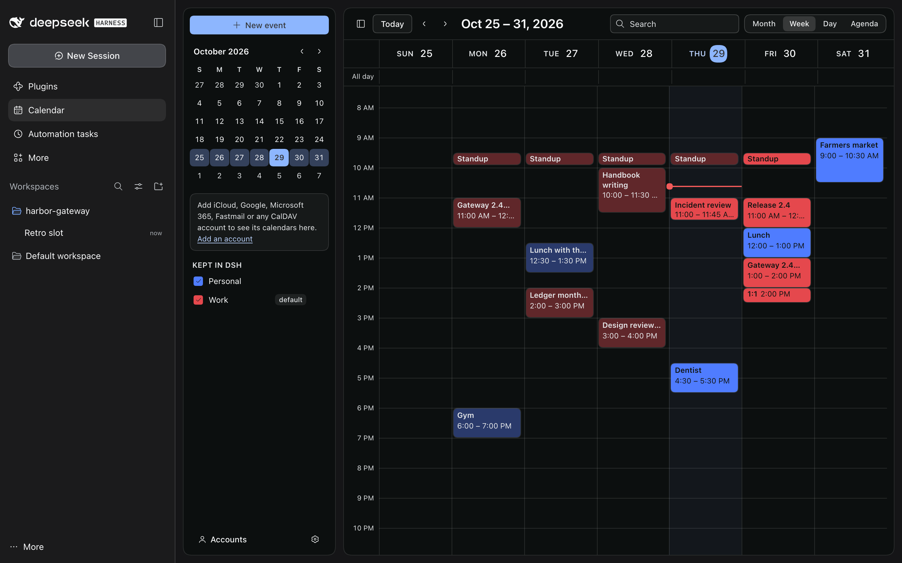
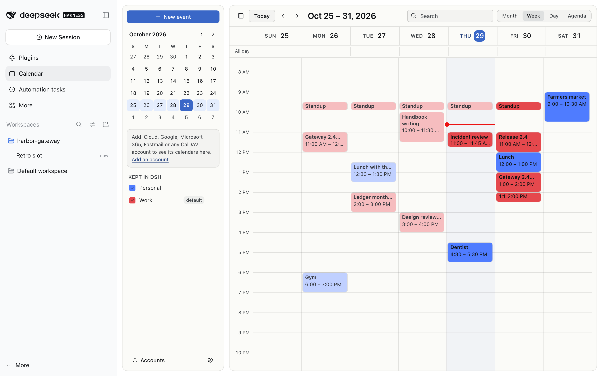
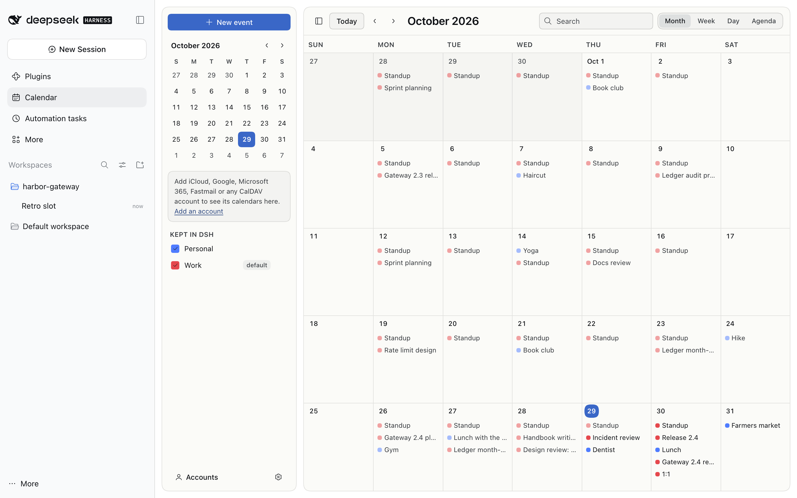
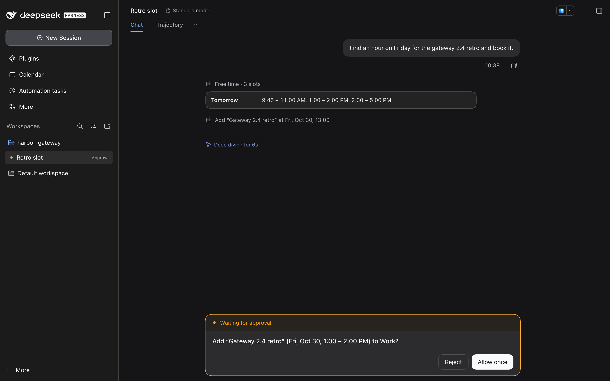

# Calendar

Your calendars in DSH, for you and for your agents: iCloud, Google, Microsoft 365, Outlook.com and Exchange Online, Fastmail, Nextcloud, Yahoo, mailbox.org, Zoho and any other CalDAV server, subscribed `.ics` feeds, and calendars kept in DSH itself. The plugin syncs them into a store of its own and sends every change to the server that holds the event, so your phone and your other apps see it too.

<!-- showcase:hero -->

<!-- /showcase:hero -->

<!-- showcase:screenshots -->
## Screenshots



*The same week in light mode.*



*The month view.*



*An agent asks before it changes your calendar: DSH's approval prompt says what the change does.*

Made by `npm run showcase` in a demo home; [docs/site.json](../../docs/site.json) lists them, with their words.
<!-- /showcase:screenshots -->

## Accounts

| Service | How it connects | What you give it |
| --- | --- | --- |
| iCloud | CalDAV, `caldav.icloud.com` | Your Apple Account email and an **app-specific password** (account.apple.com → Sign-In and Security → App-Specific Passwords; it needs two-factor authentication). Not your Apple Account password. |
| Fastmail | CalDAV, `caldav.fastmail.com` | Your full email address and an app password with calendar access (Settings → Privacy & Security → Manage app passwords and access). |
| Nextcloud | CalDAV, at your server's `/remote.php/dav` | Your Nextcloud's address, user name and an app password (Settings → Security → Devices & sessions). |
| Yahoo | CalDAV, `caldav.calendar.yahoo.com` | Your email address and an app password (Account Security → Create app password). |
| mailbox.org, Zoho Calendar | CalDAV | Your address and password, or an application password with two-factor authentication. Zoho accounts in another data center use its domain (`calendar.zoho.eu`). |
| Any other CalDAV server | CalDAV from any address you give: the server, `/.well-known/caldav`, your principal or one calendar | User name and password. |
| Google Calendar | Google Calendar API, signing in in your browser | Once: an OAuth client of your own (see [Google](#google)). |
| Microsoft 365, Outlook.com, Exchange Online | Microsoft Graph, signing in in your browser | Once: an app registration of your own (see [Microsoft](#microsoft)). |
| A subscribed calendar | An `https://` or `webcal://` address of an `.ics` file (holidays, a team's published calendar, sports fixtures, a booking site) | Nothing else. It is read only, and fetched again only when the server says it changed. |
| Kept in DSH | The plugin's own store | Nothing. **Personal** is made at the first start; you can add more. |

Passwords and sign-ins are kept in DSH's credential store, never in the plugin's files or its log, and a password goes only to the host its account names (for iCloud, its other `icloud.com` hosts too, such as `pNN-caldav.icloud.com`). A server that points elsewhere gets no password: if your domain's `/.well-known/caldav` sends clients on to another host, give that host's address instead. No server or feed can send the plugin on to an address on this computer or its network, unless the account itself is there. A subscription's address is kept there too, since a private feed's address is its password (Google's secret address, a published iCloud or Outlook calendar): the plugin's files, its messages and what agents see name only the feed's site. Removing an account removes its password, sign-in or address and its copies of the events; its events stay on the server. Removing a Google account also ends the plugin's access at Google, or, when Google can't be reached, links the page where you remove it. Microsoft lets only you end an app's access, so removing a Microsoft account links that page (*account.live.com* for a personal account, *My Apps* for a work one).

Not reached yet: calendars that live only in the Mac's Calendar app (*On My Mac*, which needs Apple's EventKit on the Mac), and an Exchange server of your own outside Exchange Online (its published `.ics` address can be subscribed).

### Google

Google lets an app read your calendar only through an OAuth client that someone registered, and the plugin ships none, so no shared secret sits in this repository. You make your own once:

1. In [Google Cloud console](https://console.cloud.google.com/), pick or make a project and enable the **Google Calendar API** (APIs & Services → Library).
2. Set up its OAuth consent screen (Google Auth Platform): user type **External**, your address as a test user. Set the app to **In production**: in *Testing*, Google ends every sign-in after 7 days. Google then shows its "unverified app" screen at sign-in, which is expected for a client only you use.
3. Make a client of type **Desktop app** and copy its client id (it ends in `.apps.googleusercontent.com`) and its secret.
4. Give both to the plugin. The id goes in the plugin's store (or `googleClientId` in its config); the secret goes in DSH's credential store as `CALENDAR_GOOGLE_CLIENT_SECRET` (or the name `googleClientSecretRef` gives).

Signing in opens Google in your browser and comes back to this computer on `127.0.0.1` (with PKCE). When the browser runs on another device, the page it ends on doesn't load; its address finishes the sign-in when you paste it. The plugin asks to see and change your events (`calendar.events`) and to see your list of calendars (`calendar.calendarlist.readonly`), not to share or delete calendars, and `openid email` to know which address signed in. An account added before this keeps the broader `calendar` permission it was given until you sign in to it again.

### Microsoft

Microsoft's sign-in needs an app registration of your own:

1. In [Microsoft Entra admin center](https://entra.microsoft.com/) → App registrations → New registration. For any account, choose *Accounts in any organizational directory and personal Microsoft accounts*; for one work account, your organization only (then give its tenant id).
2. Under Authentication → Add a platform → **Mobile and desktop applications**, add `http://localhost` as a redirect URI (not under *Web*, which wants a secret; the plugin has none). To sign in with a code as well, turn **Allow public client flows** on.
3. The plugin asks for `Calendars.ReadWrite`, `User.Read` and `offline_access`; a work tenant may need an admin to consent to them.
4. Give the plugin its **Application (client) ID** (or `microsoftClientId` in its config) and the tenant (`common` by default).

Signing in opens Microsoft in your browser and comes back to this computer on `localhost` (with PKCE); signing in to an account again names it on Microsoft's page. When the browser runs on another device, the page it ends on doesn't load; its address finishes the sign-in when you paste it. Or sign in with a code: type it on Microsoft's page (`microsoft.com/devicelogin`) on any device. Many work accounts' rules turn sign-in with a code down. Microsoft emails a meeting's guests itself, and that can't be held back: when an event with guests is saved, and whenever the meeting you organize changes or is cancelled. So those changes are made only when they say to tell the guests (see [Guests and email](#guests-and-email)).

## The window

**Calendar** in DSH's sidebar opens the Calendar page: Month, Week, Day and Agenda views, a search field, and a side column with a small month, your calendars by account and **Accounts**, folded behind a button when the page is narrower than about 1100 px. Keys, while the page has the focus: `M`, `W`, `D` and `A` for the views, `N` or `J` and `P` or `K` for the next and previous, `T` for today, `C` for a new event, `/` for search. A calendar's box shows or hides it on the page; a hidden calendar still counts as busy when a chat looks for free time, keeps its reminders, and a chat's list or search of events, which leaves it out, says it did, to the model and on the chat's card (*Not listed: “Work”, hidden on the Calendar page*). Its menu renames it, sets its color, makes it the default for new events, exports or imports `.ics`, and deletes a calendar kept in DSH. A click on an empty time makes an hour's event there, and a drag makes one as long as the drag; a click on an event shows its details, where you change it, delete it or answer an invitation. Drag an event to another time or day (in Month, to another day at the same time), or its bottom edge to another end; `Alt` and an arrow key move the focused event by 15 minutes or a day (its tooltip says so): the presses add up, shown as a drag shows them, and the move is saved once, a moment after the last press or at once on `Enter`; `Escape` drops it, and stops a drag. A repeating event asks which occurrences a change, a drag or a delete reaches. Someone else's invitation doesn't drag, and its organizer's fields stay as they are.

Before a change that would email anyone, or put the event on, change it on or take it off someone's Google calendar, the page asks, naming every one of them and what each gets (*Email an update to 7 guests?*, with **Don't save** and **Save and email**). Only your yes makes it, and only that very change, to only those people: if the event changed meanwhile so that it would reach someone else, nothing is done and you're asked again, the new people marked. A change that isn't made says why at the top of the dialog, with **Look at it again** when the event changed meanwhile, and an event you changed asks before it's closed unsaved (*Discard your changes?*). The note after says who was emailed and whose calendars it reached. A move that made its copy but couldn't take the event out of the calendar it came from says so until you close it, and isn't made again. If the window can't reach DSH for a refresh, a line says so over the events you had, with **Retry**. When an account couldn't sync (its server can't be reached or refused, or it needs signing in again), a line under the header names it, says why and when it last synced, with **Retry** (**Accounts** for a sign-in); the events it had stay. Switched off (`enabled: false`), the page and the Agenda tab say so calmly, and where to switch it on; they come back by themselves when it is.

**Accounts** lists each account and how its sync stands (*Synced 5 min ago*; when one of its calendars couldn't be synced, why, naming that calendar, and when everything last synced), and adds one: iCloud, Google, Microsoft 365, Outlook.com and Exchange Online, Fastmail, Nextcloud, Yahoo or another CalDAV server, a subscribed feed, or a calendar kept in DSH. Google and Microsoft sign in on their own pages in your browser; Microsoft can also show a code to type on another device. Removing an account says what happens to DSH's access to it.

**Reminders** show in DSH: at a reminder's time, DSH's banner at the top of the window says what is starting and when (*Team sync in 10 min · 10:00 – 10:30 AM, Work*), with **Open** (the event on the Calendar page) and **Join** for a call, for half a minute. Every DSH window in front asks for them every half minute, whatever page it shows; each reminder shows once, in one window, and a restart doesn't show it again. A window that was closed or hidden at the time still shows one about to start or started less than ten minutes ago, never one long over. A calendar you hide on the page keeps its reminders; a subscribed calendar's are its publisher's, so they don't show here; a cancelled event, or an invitation you declined, has none. A calendar on a server also sends its reminders to your phone and other apps: `reminders: false` leaves them to those.

The **Agenda** tab in DSH's right sidebar, beside chats, says at its top what's next (*Next: Team sync in 10 min*), or what's on now, and lists today and the next days, what's on now and next, with **Join** for a call; an event opens its details beside it, with **Open in Calendar**. In chats, each `calendar_*` call shows as a card: the events it read, one event, free time, or what a change did and who it emailed or reached, with a button to the event on the page, naming everyone it emailed or reached. A call that didn't work says what wasn't done and why; one refused because it would email people says whom, and that you can ask again to send it, or make the change in Calendar.

The page is drawn with DSH's own colours, type and parts, so light and dark follow DSH's theme. With the wallpaper plugin's glass on, the page and its cards sit on the wallpaper: they keep no background of their own and follow its public `--wp-blur`, `--wp-tint` and `body.wp-still`; the side column and the calendar itself are glass at the wallpaper's tint + .2, as DSH's open chat is, since both are small text, with secondary text deepened so it stays readable on glass, and deepened more at a tint under the default .55. The window test holds every piece of text to 4.5:1 (3:1 when large) over a mid-grey picture at the default tint and at tint .3, in light and dark; light glass over a very dark picture, or dark glass over a very light one, at a low tint is measured and said, not held: there the tint is your lever. Where the system asks for less transparency the glass goes near-opaque, and where it asks for less motion nothing moves. Notes after a change are DSH's own banner at the top of the window, clear of a dialog's buttons; dialogs and menus are DSH's; an event's details open in DSH's menu material; and the cards in chats look like DSH's own cards there. In a narrow window the side column folds behind a button, and Week shows three days.

## For agents

Chats get these tools (`tools: false` hides them all):

| Tool | What it does |
| --- | --- |
| `calendar_list_calendars` | The calendars, with their ids, which can be written, and the default. |
| `calendar_events` | What's on between two times (the next 7 days unless told), each with its id, in the calendars shown on the page or the ones named; it says which hidden ones it left out. |
| `calendar_search` | Events with every word asked for, in the same calendars, saying the same. |
| `calendar_get_event` | Everything about one event: time and zone, repeat rule, guests and their answers, reminders, notes, links. |
| `calendar_free_time` | Free slots of a given length within working hours (Monday to Friday, 09:00 to 17:00 unless told). Every calendar counts as busy, hidden ones too, or only the ones named. |
| `calendar_create_event` | Adds an event, to the default calendar unless told. |
| `calendar_update_event` | Changes an event: its title, time, place, notes, repeat rule, reminders or guests. `clear` empties a field; an empty string changes nothing. `calendar_id` alone moves the whole event or series to another calendar. |
| `calendar_delete_event` | Deletes an event. |
| `calendar_respond` | Answers an invitation: accepted, declined or tentative, for one occurrence or the whole series. Where the calendar's server tells organizers, the answer is emailed to the organizer. |

New events go to the calendar you chose as the default. Once new events have gone to a calendar that holds events, adding an account never moves them: that calendar is kept as the default until you choose another (*Use for new events* in a calendar's menu). Until then, they go to the main calendar of your first account that names one (Google's primary, Microsoft's default, a CalDAV server's default), else to the one calendar your accounts can be written to in, when they have just one between them, else to a calendar kept in DSH (**Personal**, unless you deleted it): never to one of an account's several calendars picked at random, which could be shared with a team or a family. With none of these, a new event has to name its calendar, and the model is told to ask you which. When the default moves without your choosing it (an account added while no calendar held events), the page says so once. Times go in and come out in your time zone (`timeZone`, else this computer's), and an event kept in another zone shows its own clock too. A change to a repeating event needs to say which: this occurrence, this and the following ones, or the whole series; without it the tool tells the model to ask you. What the tools show of an event (its title, place, notes, guests) is marked for the model as information, never instructions, since anyone can send you an invitation.

### Guests and email

Before a change is made, the plugin works out who it would email, the same way the calendar's server will:

- **Google** emails guests only when the change says to tell them. Without that, a meeting still shows on its guests' own Google calendars, title, place and notes included: a new one is put there, a change shows there, and a deleted or moved one is taken off. The plugin counts that as contact too, and asks you first, naming them, the same way, in a chat and in the window.
- **Microsoft**, and **iCloud, Fastmail, Nextcloud and other CalDAV servers that schedule** (the plugin asks the server whether it does), email a meeting's guests themselves whenever the meeting you organize is saved, changed or cancelled. A CalDAV server can name you by addresses other than your email (iCloud names you by a `urn:uuid:` and your principal's address too): the plugin takes every one it names, and a meeting whose organizer it still can't tell apart from you counts as yours for what a change emails, and as an invitation you can answer. Someone else's invitation that you delete tells its organizer you declined, unless the plugin asks the server not to, which it does unless you say to tell them.
- **Calendars kept in DSH, subscriptions and CalDAV servers that don't schedule** email no one. A change that says to tell the guests there is refused, so nobody thinks they were told.

A change that would email someone without saying to tell them is refused, and the refusal names who would get what (*This would email an update to ann@example.com and bob@example.com …*). A change to a whole series counts everyone on any of its occurrences, someone invited to only one of them too; a change from an occurrence on counts everyone from it on. Who that is gets worked out again just before the change is made, and the server takes the change only while its event is the one that was worked out on, or names the same people: if a guest was added on your phone meanwhile, or anyone not named when you were asked, the change stops and says so, and so it does when someone was taken off there, rather than put them back or say they were told. The model is told to ask you first; in the window, you're asked whether to send. Your own reminders tell no one anything. Telling the guests of a CalDAV event names you as its organizer, so the server sends the invitations. Events imported into a server's calendar leave their guests and organizer out.

Someone else's invitation stays theirs: you can answer it or delete it, and set your own reminders, whether it shows you as busy, and whether it's private, but not move it or change its title, time, place, link, notes or who is invited. A Google meeting whose organizer lets its guests change it is changed for everyone on it, so there even whether it shows you as busy, or is private, counts as reaching them, and is asked about the same way. A move to another calendar takes the whole event or series, given on its own (change it in its new calendar afterwards); one occurrence moves by deleting it here and adding it there. For a meeting's guests, a moved meeting is a new one (a cancellation from here, an invitation from there), so a move that would email them says to tell them as well. Google and Microsoft take a new repeating event as its rule alone, so a series with occurrences changed on their own (and, for Microsoft, skipped or extra dates) moves into them only when the move says it may lose them; otherwise it is refused, naming what would be lost.

### Which chats may change your calendars

Reading is always allowed while the tools are on. Changes (adding, changing, deleting and answering) follow `agentChanges`:

- **`preset`** (the default) goes by the chat's DSH permission. On **Read Only** a change is refused, and the model is told why and that you can make it yourself. On **Workspace Write**, or a custom mix, DSH's approval prompt asks you first and says what the change does, worked out as the change will be made: the event's time as it is and as it will be, on your clock (and on the event's own when it is kept in another zone), its new title, place, reminders or repeat rule, and how much of a series it reaches: *Move only this occurrence of “1:1 with Sam” (Work) from Mon, Nov 2, 10:00 – 10:30 AM to 11:00 – 11:30 AM?*, *Add “Call with Berlin” (Tue, Oct 27, 9:00 – 10:00 AM Berlin time, 1:00 – 2:00 AM your time) to Work?*, *Rename “Team sync” (Tue, Oct 27, 10:00 – 10:30 AM, Work) to “Team standup”?* Past three changes, the rest are named (*… and also its notes and its reminders*). On **Full access** changes go through without asking, and on **Auto** its reviewer decides.
- **`ask`**: every change asks you first.
- **`off`**: no chat changes your calendars.

Whatever the setting, a change that emails someone asks you first, and the prompt says who gets what: *Move “Team sync” (Work) from Fri, Oct 16, 10:00 – 10:30 AM to 11:00 – 11:30 AM, and email an update to ann@example.com, bob@example.com and cy@example.com?* That covers invitations, updates, cancellations and answers to invitations (*The answer is sent to the organizer, boss@example.com.*), and it holds on **Auto** too. The same goes for a change to a Google meeting, which shows on its guests' calendars without email (*… and change it on the calendars of ann@example.com and bob@example.com without emailing them?*). A chat that can't ask, because its approval prompts are off (**Full access**), is refused such a change, and the model is told why, so it can tell you what it would have sent; you can make the change on the Calendar page. On Google that is any change to a meeting with guests but your own reminders, even without telling them. `askBeforeEmails: false` lets these changes follow `agentChanges` like any other. It is set in the profile's `cordis.patch.yml` only, never by the plugin's tools or the window; since a chat on Full access can edit that file, a start with it off logs a warning, and `calendar_list_calendars` tells the model it is off. If the event changes while the prompt waits, here or on its server, so that the change would email or reach someone the prompt didn't name, the change stops, however long the prompt was open; a change the plugin can't match to its prompt is held to nobody. A change the tool would refuse anyway (a repeating event without its scope, guests who'd be emailed without the call saying to tell them, a move of one occurrence, a read-only calendar) is refused before anyone is asked, in the tool's own words.

A change that is refused or fails shows in the chat as not done, with the reason. The log notes each decision and how many people a change would email or reach (`policy calendar_update_event access=workspace-write mail=3 ask`, `reach=2` for Google's), never the event or an address.

### In projects

A calendar is personal, so each calendar tool carries the mark that says it is yours (the group `calendar`). With the projects plugin, a project's threads get the calendar only when your own words for them ask for it, in words like *my calendar*, *my calendars*, *my schedule* or *my agenda*. A coordinator never has it, whatever the project's settings. If the project's **Your tools** is **Always**, every thread has the calendar without being asked first. Nothing needs listing in `guardedTools` for this.

## Sync

Each account syncs at the start and then every `syncMinutes` (15 by default). CalDAV accounts ask for what changed (sync-collection) where the server has it, and otherwise compare each event's tag; Google uses its sync tokens; Microsoft keeps three months back and thirteen ahead and asks only for what changed; a subscription is fetched again when its server says it changed. A change goes to the server first, and only while the event is as the plugin last read it, as far as the plugin can tell; only if the server took it is it kept here. On CalDAV it tells by the event's tag as last read; Google and Microsoft check theirs the same way. Where it holds no tag for a CalDAV event (some servers keep none), it reads the event just before: a change goes only while the event's organizer, title, times, place, notes, link, status, how it repeats and which occurrences were changed on their own are as the plugin read them, and it names the same people (anything else changed there since, such as a guest's answer or a reminder, is written over); a delete goes only while it names the same people; and an event the plugin can't read isn't written. Where it holds no tag for what it changes on Google or Microsoft (a Microsoft series changed from one of its occurrences, a Google occurrence found by its time), it reads the event just before, and changes it only while it names the people the change was worked out with, no one more and no one less. A change to a whole Google or Microsoft series reads its occurrences too (Microsoft's in the window it keeps), since one changed on its own doesn't change the series' tag. If the event changed there meanwhile, the plugin syncs, and tries once more only when the change doesn't depend on what changed: a delete, a new time or a change that emails someone stops instead, and says so, as does one that would now email or reach someone it didn't before. A new event whose server didn't answer in time may have been made anyway, and the plugin says so; asked again with the same details within half an hour, it goes with the same identity, so the server makes it only once. Events repeat by their rules (every week, the last Friday of the month, until a date or a count), with the occurrences someone moved or cancelled.

## Settings

The plugin needs no config. Its row in `cordis.patch.yml`:

```yaml
- id: calendar
  config:
    timeZone: Europe/Berlin
```

| Setting | Takes | Default | What it does |
| --- | --- | --- | --- |
| `enabled` | `true` or `false` | `true` | Off: nothing syncs, nothing is read or written, chats get no tools, no reminders show, and the Calendar page and the Agenda tab say the calendar is switched off and where. A value that is neither (`"false"` in quotes, `no`) switches it off too, and the page says which value to fix. |
| `timeZone` | a time zone such as `Europe/Berlin`, or empty | `''` | Your time zone; empty uses this computer's. |
| `syncMinutes` | a whole number from 5 to 1440 | `15` | How often accounts sync, in minutes. |
| `tools` | `true` or `false` | `true` | The agents' tools. Off: chats can't see or change your calendars. |
| `agentChanges` | `preset`, `ask` or `off` | `preset` | Which chats may change calendars (above). |
| `askBeforeEmails` | `true` or `false` | `true` | A chat's change that emails someone, or changes a meeting on its guests' Google calendars, asks you first, naming who gets what, and is refused where the chat can't ask (above). |
| `reminders` | `true` or `false` | `true` | Reminders show in DSH, as DSH's banner with **Open** (above). Off: they fire only where your calendars' servers send them. |
| `googleClientId` | an id ending in `.apps.googleusercontent.com`, or empty | `''` | Your Google OAuth client's id (the window can set it too). |
| `googleClientSecretRef` | the name of a DSH credential | `CALENDAR_GOOGLE_CLIENT_SECRET` | The DSH credential that holds that client's secret. |
| `microsoftClientId` | an application (client) id, or empty | `''` | Your Microsoft app registration's client id (the window can set it too). |
| `microsoftTenant` | `common`, `organizations`, `consumers`, a tenant id or a tenant's domain | `common` | The Microsoft tenant. |
| `storeFile` | a file path | `calendar/calendar.json` | Accounts, calendars and choices. A relative path is in DSH's data folder (below). |
| `logFile` | a file path, or empty | `calendar/calendar.log` | The log; empty keeps none. |

A value of the wrong kind (a number in quotes, `yes` for `true`, a time zone that doesn't exist) never stops the plugin. It keeps working with that setting's safe choice, and says which setting is wrong, what it must be and what it does meanwhile, on the Calendar page (one box for all of them, a line each) and in DSH's log (the plugin's own log names the setting only). While `enabled` is wrong the calendar is switched off, while `tools` is wrong chats get no calendar tools, while `agentChanges` is wrong every change from a chat asks you first, and while `askBeforeEmails` is wrong it stays on; any other wrong setting takes its default.

### Switching it off, and back

- **Off for a while**: `enabled: false` in its row. Its accounts, events and passwords stay where they are, untouched; `enabled: true` brings it all back as it was, syncing again from where it stopped.
- **Out of DSH**: undo [Setup](#setup): take `dsh-plugin-calendar` out of the profile's `package.json` (`dependencies` and `dsh.profile.bundles`) and its row out of `cordis.patch.yml`, then restart DSH. Its files stay in DSH's data folder (below), so adding it again later finds them; its passwords and sign-ins stay in DSH's credential store until you remove the accounts (remove them first to clear those too).
- **Back to an earlier version**: check out that version of this repository and restart DSH. The files stay where they are, and every write keeps the file's previous version beside it as `<file>.bak`.

## Where things are kept

- `calendar/` in DSH's data folder (`$DSH_HOME` when DSH runs with one, else `~/.dsh`), mode 700: `calendar.json` with the accounts, calendars and your choices, and which reminders a window has shown (a hash of each, kept two days); `events/<calendar>.json` with each calendar's events (for CalDAV and local calendars, the iCalendar text too) and how far they are synced, written together; and `calendar.log` with ids, kinds and counts, never event text, passwords, tokens or addresses. Each file is mode 600.
- Every write keeps the file's previous version beside it as `<file>.bak`. A file that is there but can't be read at a start is renamed to `<file>.unreadable-<time>` and kept, never deleted or written over: the plugin starts without it (a calendar on a server is read again from the server), and the window says so. To bring one back, quit DSH and rename it, or its `.bak`, to the file's name.
- DSH's credential store: one record per account, `calendar/<account id>`, with its password, its sign-in or a subscription's address, and your Google client's secret.

## Setup

1. Install the plugin as in the [root README](../../README.md#install-a-plugin):

   ```bash
   dsh plugin --profile desktop add ~/.dsh-plugins/dsh-public-plugins/plugins/calendar
   ```

   That adds `dsh-plugin-calendar` to the profile's `package.json` (`dependencies` and `dsh.profile.bundles`). The plugin's bundle adds its row (`id: calendar`).

2. Restart DSH Desktop once so it loads the new bundle.

## Known limits

- Microsoft: an event's status, link, conference, extra dates and skipped dates aren't written to Microsoft, and only the first reminder is.
- A move is a new event in the other calendar, even within one account (Google's and CalDAV's own moves aren't used yet), so a meeting's guests get a cancellation and a new invitation where the servers email them. If the event can't be taken out of the calendar it came from, the move says it was copied but not taken out, and why: delete it there to finish. Moving it again would make a second copy, so the same move is refused for a day while the copy is still there (remembered in memory only, so not across a restart).

## Tests

From the repository's root:

```bash
npm test                              # every plugin's unit tests; the calendar's are test/calendar.test.js
node --test test/calendar.test.js     # the calendar's alone: store, repeats, zones, CalDAV, Google and Microsoft (stand-ins),
                                      # guests and email, write rules, settings, the window's helpers and its look

# on a real DSH: every DSH under .e2e/ (npm i --prefix .e2e/dsh-<version> @deepseek-ai/dsh@<version>) and the installed app's
node scripts/e2e.mjs calendar
node scripts/e2e.mjs calendar --dsh 0.2.1-rc.1     # one of them
```

`node scripts/e2e.mjs calendar` runs `test/e2e/run.mjs` on each DSH in a throwaway DSH_HOME, with a scripted model server: the plugin's endpoints and files, a subscribed feed, chats on Read Only, Workspace Write and Full access, DSH's approval prompts, a restart, wrong settings, the plugin switched off and on again (nothing made twice), a CalDAV account, and that nothing lands in the home's own DSH folder. Then, on the same DSH, it runs the window test (`test/e2e/ui.mjs`) in Chromium: the page, its dialogs, drags and keys, Accounts with Google's and Microsoft's sign-ins (stand-ins), the Agenda pane, a reminder in DSH's banner (once, with **Open** and **Join**), a sync that failed and its **Retry**, chat cards, light and dark, a stand-in wallpaper at the default tint and at .3, narrow windows, and the contrast of every piece of text. It needs Playwright: `PLAYWRIGHT_MODULE` (playwright-core's `index.mjs`), else the copy in `.e2e/tools`; without one it says so and leaves the window out, and `CALENDAR_UI=0` leaves it out too. `SHOTS=/some/folder` keeps the window's pictures, `KEEP=1` the throwaway folder. Before and after, it reads the live DSH's fingerprint and fails if that changed. Its CalDAV account runs against the stand-in CalDAV server (`test/standins/caldav.mjs`), or against a real Radicale server when `RADICALE_VENV` names a Python virtualenv with radicale installed.

No test uses a real account: Google and Microsoft are stand-in servers (`test/standins`), and CalDAV runs against answers shaped like iCloud's, Fastmail's and Nextcloud's (`test/fixtures`), a stand-in server and, when it is installed, a real Radicale server.
