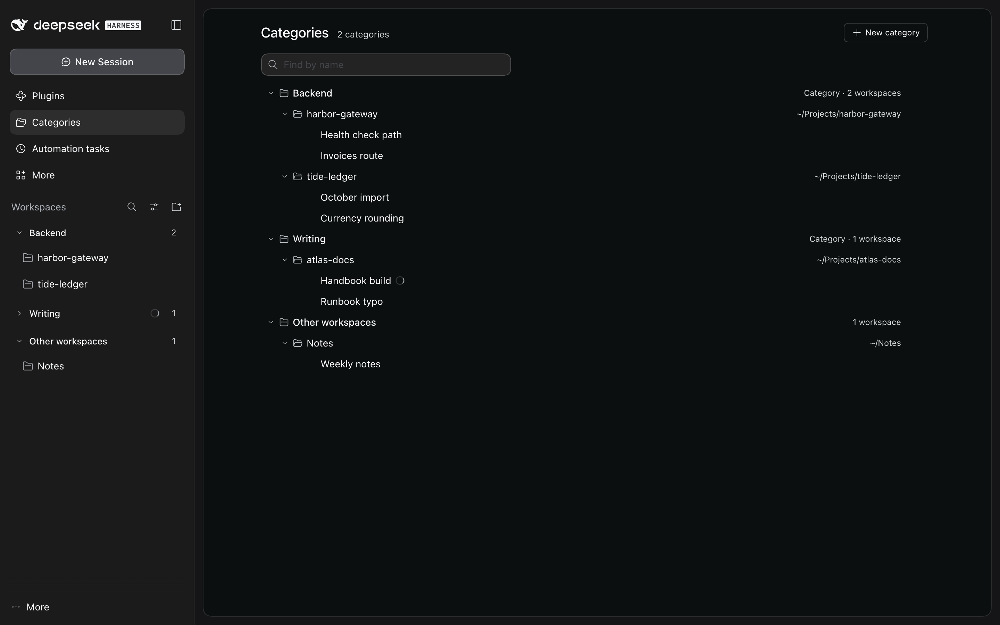
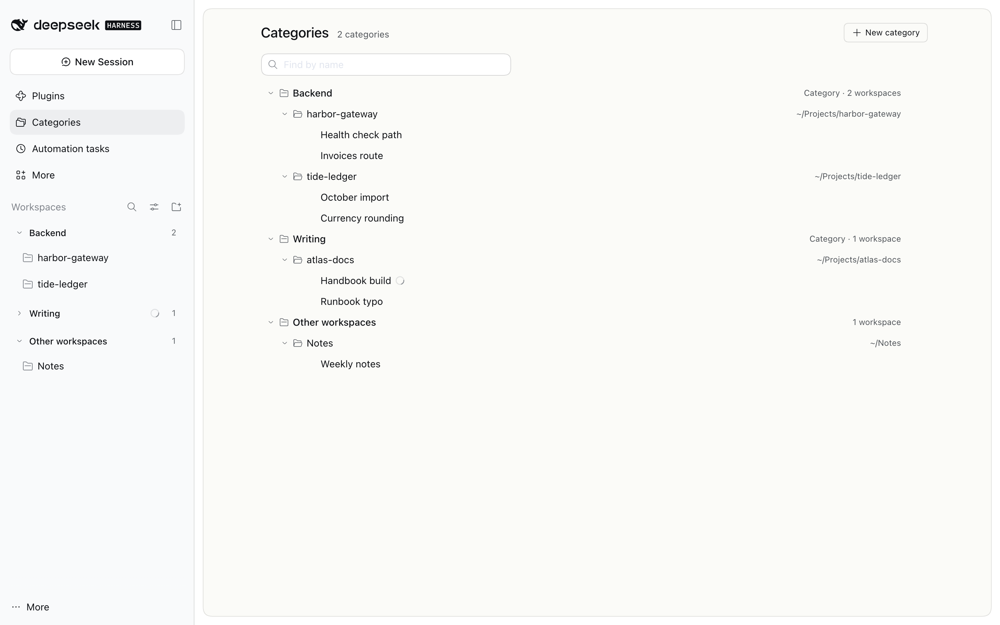
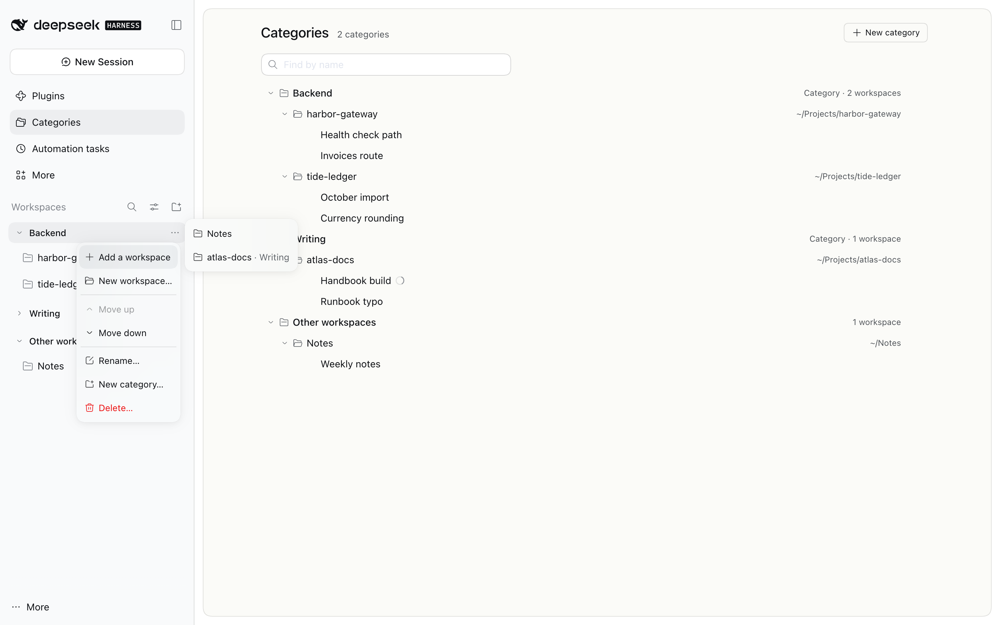
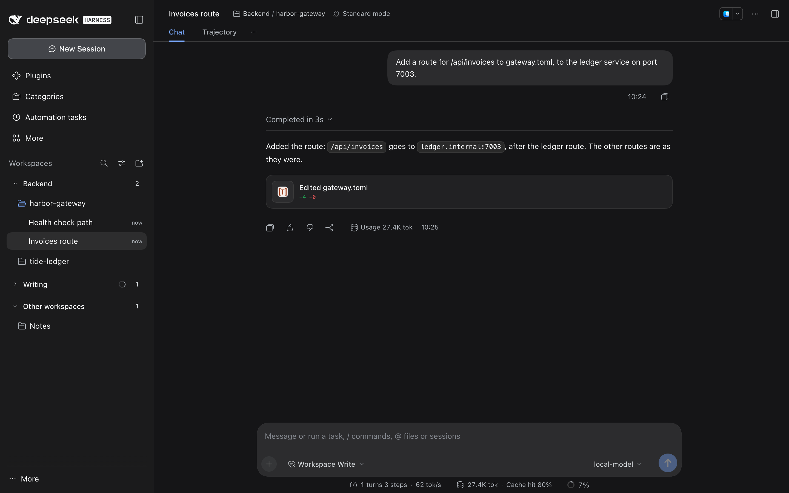

# Categories

Categories group your DSH workspaces in DSH's session list: a header for each category over its workspaces, then **Other workspaces** for the rest. The plugin works on its own; with the coordinator plugin on too, each decorates DSH's own rows, so a coordinating chat and its threads stay in their workspace and the workspace sits in its category.

<!-- showcase:hero -->

<!-- /showcase:hero -->

<!-- showcase:screenshots -->
## Screenshots



*The same page in light mode.*



*A header's menu: add a workspace, make one, move the category, rename it or delete it.*



*At the top of a chat, a chip names its category and its workspace.*

Made by `npm run showcase` in a demo home; [docs/site.json](../../docs/site.json) lists them, with their words.
<!-- /showcase:screenshots -->

## In the window

### Session list

- **Headers.** DSH's list is grouped by category: a header for each category (its name and how many workspaces it holds) over its workspaces, then **Other workspaces** for the rest. With no categories yet, Other workspaces heads the whole list, so its **⋯** can make the first. A screen reader hears each workspace's category (*in Shop*) and what each change did.
- **Folding.** Click a header, or press Enter or Space on it, to fold it; → opens it, ← folds it, and ↑ and ↓ go to the next header. A folded category shows a dot when one of its chats waits on you or runs, and a folded workspace shows the same dot on its own row, read with the workspace's name. In Workspace Tree a folded folder's dot counts its own chats, not those of the workspaces nested in it, and DSH's Ungrouped bucket shows none.
- **Long names.** A name too long for its header is cut once, at a word, with "…"; pointing at the header, or giving it the keyboard, shows the whole name in DSH's tooltip, and a screen reader hears it whole. A single word too long for the header is cut by the browser instead. At DSH's sidebar width a name of 24 characters or fewer shows whole.
- **The ⋯ menu.** A header's **⋯**, a right-click, Shift+F10 or the context-menu key on the header opens its menu; opened by a key, the keyboard goes into it, and Escape gives it back to the header's ⋯, where the header's keys still work. A category's menu:
  - **Add a workspace**: the workspaces in no category first, then those in other categories, each with where it is now (*storefront · Shop*, read as *storefront, now in Shop*).
  - **New workspace…**: DSH's own Add workspace (the folder dialog of its button over the list); the workspace DSH makes is filed in this category. A folder DSH already has adds no workspace, so nothing is filed.
  - **Move up**, **Move down** (Alt+↑ and Alt+↓ on the header too), **Rename…**, **New category…** and **Delete…**.

  Other workspaces' menu has New workspace… (filed in no category) and New category….
- **Dragging.** Drag a header to move its category, or a workspace's row onto a header or another workspace's row to file it there; DSH's own drop line shows where it goes.
- **Dialogs.** Rename… and New category… ask for a name; Delete… asks first, and says the category's workspaces go to Other workspaces (no chat or folder is deleted). No two categories share a name: names are compared without regard to case, extra spaces, or how an accent is written, so *Shop* and *shop* can't both exist, though a category can change its own name's case. When a dialog closes, the keyboard goes back to the header it was opened from; after a delete, to the header now in that place.
- **When a change can't be made**, the plugin says why: under the field of the dialog that asked (the keyboard stays there), or in DSH's banner at the top of the window. A change that can't be saved (a full disk, no permission to write) is undone and refused, so the window never shows what the next start would lose: *Not saved: ~/.dsh/categories/categories.json can't be written (the disk is full), so nothing changed. Try again once it can be.*

DSH has no seat for a header in its list, so the headers are the plugin's own elements, and CSS sets each workspace's section under its category, one step in by DSH's own workspace indent (`sidebarRules` in `lib/client.js`). The CSS goes by attributes the plugin puts on DSH's list and its sections, kept in step at every change to the list (`markList`), never by what an element holds, so a change in one workspace restyles that workspace, even in a list of hundreds of chats. DSH's workspace rows have no seat for a dot either, so a folded workspace's dot sits in an element of the plugin's own in its row, before DSH's row actions, and goes when the workspace opens or nothing in it runs (`markWorkspaceDots`). DSH's rows, their order within a workspace, its view options and its search stay its own; **In one list** and search results show no headers, and a folder's nested workspaces in Workspace Tree keep DSH's own drag.

### Categories page

**Categories** in DSH's sidebar, next to Plugins and Automation tasks, opens a page with the whole tree, on one glass card (beside the Wallpaper plugin too).

- **The tree.** Each category with its workspaces in DSH's order, each workspace with its sessions in DSH's order, and last **Other workspaces**, the ones in no category. Every session DSH lists is there, except archived ones and an empty **New Session**, each by its DSH title and with DSH's own dot when it runs or waits on you (named for screen readers). Each row says what it is: a category reads *Category · 3 workspaces*, and a workspace shows its folder, so a category and a workspace can share a name and still look apart. DSH's own default workspace is *Default workspace*, as DSH's list names it.
- **Find by name**, above the tree, keeps every category, workspace or session whose name holds what you type (in any case), each where it lives and with what's in it, the words in bold; ↓ goes into the tree, Escape or its **×** clears it, and what you close while finding is forgotten when the find changes.
- **Keys.** The tree is one tab stop: ↑ and ↓ go through it as drawn, → opens a row or goes into it, ← closes it or goes to its parent, Home and End go to the ends, and Enter or a click opens a session, or opens and closes a category or a workspace; a row's chevron opens and closes it. Alt+↑ and Alt+↓ move the category or workspace that has the focus, and the focus stays on it: a workspace moves past its neighbour, and from the top or bottom of its category into the one above (at its end) or below (at its start), opening it, or into Other workspaces past the last category. Each move is said, and so is the reason when an item can't go further (the first or last already, or Other workspaces, which always comes last). A session's place stays DSH's.
- **Menus.** A category's row has the session list's **⋯** menu, and Other workspaces' row makes a new workspace or a new category. A workspace's row has a menu of its own, which DSH's session list has no place for: **Move to** another category or Other workspaces, **New category with it…**, and Move up and Move down in its category. ⋯ shows while a row is pointed at, has the focus or has its menu open; a right-click, Shift+F10 or the context-menu key opens it too. The heading counts the categories, and **New category** makes one, last in the list. Each change is said, or refused with the reason, and a dialog gives the keyboard back to its row as in the session list (after a delete, to the row now in its place; after New category with it…, to the workspace in its new place).
- **Notes at the top**, each only while it applies:
  - With workspaces but no category yet: what categories are for, and how to make the first.
  - *Not saved*, when the plugin's store can't be written: which file and why, and that a change made meanwhile is undone. It goes once a change saves.
  - *The categories file couldn't be used*, when the store was there at the start but couldn't be read (not JSON, another version): the categories started empty, and where the file as it was is kept, to put back by hand.
  - *A setting is wrong*: which setting in the profile's row, what it counts as meanwhile, and where to fix it.
  - The categories this plugin's own one-time import made from the old sidebar, and that their old instructions, files and defaults for new sessions weren't carried over, until you dismiss it. Categories the projects plugin had imported before, which came over with the rest, aren't named.

### At the top of a session

A session whose workspace is in a category shows *Category / workspace* among DSH's header buttons, just before the coordinator plugin's **Threads** menu when that plugin is on; a subagent's or a teammate's shows its parent's. It follows the categories, so a rename or a workspace filed elsewhere shows there too. A click opens the Categories page; where DSH offers no way to it, it is plain text. A screen reader hears *Category: Shop, workspace storefront*. A long name stays on one line and ends in "…", giving way before the session's title does, and the chip hides where the header is narrow (a pane open beside the session). Nothing shows for a blank, archived or unknown session, or one whose workspace is in no category.

### What the window keeps

The folded categories, the rows closed on the page and a dismissed note are kept in the window's own storage, under `dsh-plugin-categories/`, so they hold across restarts. They start fresh: what the projects plugin kept for its own categories isn't read.

Every control the plugin draws shows DSH's focus ring when you reach it with the keyboard. The browser half reads only DSH's own lists (workspaces, sessions and their status) and this plugin's endpoints; it reads no other plugin's data or marks, and it hides or moves nothing of another plugin's.

## How it works

The plugin keeps its own store, `~/.dsh/categories/categories.json` (in `$DSH_HOME` when DSH runs with one): each category's name and place in the list, and which category each workspace is in. A workspace is in one category at most. The store and the log beside it are mode 600, in a folder of mode 700. The log holds ids and counts, and what went wrong in words (a wrong setting, a call that failed, a move that could not be made); DSH 0.2 writes no plugin's log lines out, so this file is where the plugin's warnings can be read.

Every change is written to the store at once. A change that can't be written (a full disk, no permission) is undone and refused in words, the log has a line for it (`warn could not save the categories in … (EACCES): the change is undone, and the next change tries again`), and the list tells the Categories page, which says so until a change saves. So neither the window nor the log ever shows a change the next start would lose.

A store that is there but can't be used (not JSON, another version, unreadable) never stops the plugin: the categories start empty, the log warns (`warn the store … is not JSON: the categories start empty, …`), the Categories page says so, neither one-time move below runs over it, and before a change writes a new store the file as it was is kept beside it as `categories.json.unreadable-<time>` (mode 600), so you can put it back by hand (the page then names that file).

DSH keeps one workspace order for every window, and its session list draws it. The plugin keeps that order in step with the categories, through the same call DSH's own workspace drag makes: each category's workspaces together, the categories in their order, then the workspaces in none. It moves as few workspaces as it can. A workspace DSH adds later (DSH puts a new one first) goes back among the ones in none the next time the window lists the categories.

Deleting a category deletes nothing in DSH: its workspaces and their chats go to Other workspaces.

### Once, at the first start

Two moves run once, when the plugin starts in a DSH for the first time (before its store exists):

1. **Categories from the projects plugin.** Before this plugin, the projects plugin kept the categories, in its store (`~/.dsh/projects/projects.json`). Whatever categories that store holds when the plugin first starts come over exactly as they are: the same ids, names, order and workspaces. None is renamed or left out, including one with the same id as a ◆ project. A workspace placed in one that DSH no longer has stays recorded and isn't shown. The projects store is only read; it is copied first to `~/.dsh/categories/from-projects.json` (a later move never overwrites that copy).
2. **Your old sidebar, only when there were no categories yet.** The all-in-one mod's old sidebar kept projects of workspaces in `~/.dsh/fleet-shell/state.json`. When the projects store has categories, they are your categories as you left them (some made from this file, perhaps deleted since), so the old file isn't read at all. Otherwise (no projects store, or one from before categories) each old project becomes a category, in the same order, holding the same workspaces. Only names and which workspaces each held come over: the old instructions, files and defaults stay behind. A name that is already a category here joins it; a workspace already in a category, or one DSH no longer has, stays where it is. The old file is only read, and an import the projects plugin already made isn't made again.

A projects store from before categories, where projects were also groups of workspaces, gives its groups as categories, except a project that has a coordinator and holds only its own workspace: that one stays a project, not a category.

A store that can't be read (other than missing) is logged, and its move is tried again at the next start.

To see what both will do before the first start, without changing anything:

```bash
node plugins/categories/scripts/import-preview.mjs
```

It reads `$DSH_HOME` (else `~/.dsh`) and names workspaces as DSH's list does (DSH's default one as *Default workspace*, one DSH no longer has as such, never by an id); once the moves have run, it says when.

The projects plugin keeps its old categories in its own store as they were, so an older version of it still finds them. Neither plugin reads or writes the other's data after this one move.

Each start reads the store from its file. Switched off in DSH's Plugins page (or reloaded by a config change), the plugin stops changing anything, and switched on again it starts from the file as it is then.

## Setup

1. Install the plugin as in the [root README](../../README.md#install-a-plugin):

   ```bash
   dsh plugin --profile desktop add ~/.dsh-plugins/dsh-public-plugins/plugins/categories
   ```

   That adds `dsh-plugin-categories` to the profile's `package.json` (`dependencies` and `dsh.profile.bundles`). The plugin's bundle adds its row (`id: categories`); it needs no config.

2. Restart DSH Desktop once so it loads the new bundle. The categories you had come over at that start (see above), and the session list shows them.

### Config

Optional, in the profile's `cordis.patch.yml`, addressing the plugin's row by id. A patch row replaces the row's whole `config`, so list every key you set:

```yaml
- id: categories
  config:
    enabled: true
    storeFile: ~/.dsh/categories/categories.json
    logFile: ~/.dsh/categories/categories.log
    projectsStoreFile: ~/.dsh/projects/projects.json
```

| Key | Type | Default | Effect |
| --- | --- | --- | --- |
| `enabled` | true or false | `true` | Off: no headers, no chip, no changes to DSH's workspace order; the Categories page says it is off and how to switch it on. The store is kept as it is. A word or number that plainly means off (`"no"`, `"off"`, `"false"`, `0`) counts as off, anything else as on; either way the page names it until it is true or false. |
| `storeFile` | a file path | `~/.dsh/categories/categories.json` | The categories and their workspaces (mode 600, in a folder of mode 700). |
| `logFile` | a file path, or empty | `~/.dsh/categories/categories.log` | The plugin's log: ids and counts, and what went wrong in words. Empty turns it off. |
| `projectsStoreFile` | a file path, or empty | `~/.dsh/projects/projects.json` | The projects plugin's store, read once at the first start (see above). Empty skips that move. |

A path under `~/.dsh` follows `$DSH_HOME`. DSH reads the row when it starts, so restart DSH after an edit; the plugin then starts with the new values. (A profile whose `package.json` has `"dsh": {"profile": {"patchReload": "live"}}`, as DSH Test's profiles do, applies an edit within seconds instead.)

**A wrong value never stops the plugin.** A value of the wrong type (a number for a path, an empty `storeFile`) counts as that key's default, and `enabled` as above; its log warns once at start (`warn a setting is wrong: enabled must be true or false, but it is "no"; it counts as false until you change it`), and the Categories page names it in a note until it is fixed. Every endpoint answers in words: a change it can't make is refused with the reason, and anything else is answered "Categories could not do that: …" and logged.

## Switching it off

- **Just the categories**: set `enabled: false` in its row and restart DSH. DSH's session list is DSH's own again (no header, not even Other workspaces), the chip goes, DSH's workspace order is left as it is, and the Categories page says the categories are off and how to switch them on. Your categories stay in the store; `enabled: true` brings them back as they were.
- **The whole plugin**: its switch on DSH's Plugins page. Its headers, its marks on DSH's list, the chip, the Categories entry and page, and its style sheet all leave the window; DSH's list shows every workspace as DSH draws it. Switched on again, it reads its store from the file and draws everything once.

## Rollback

- To an earlier version: point the profile at the earlier checkout of this folder (or `git checkout <earlier commit> -- plugins/categories`) and restart DSH. The store's format is unchanged, so an earlier version reads it as it is; a profile row with a value of the wrong type stops an earlier version, which checked types strictly.
- To before this plugin: remove `dsh-plugin-categories` from the profile's `package.json` (`dependencies`, which `dsh plugin --profile desktop remove dsh-plugin-categories` does, and `dsh.profile.bundles`) and restart DSH. DSH keeps the workspace order the plugin last set; nothing else in DSH changes. The projects plugin's store was only read, and `from-projects.json` holds the copy taken at the first start. Delete `~/.dsh/categories/` to leave nothing behind.

## Tests

```bash
npm test                                   # the whole repository: these host and window tests included
node --test test/categories-host.test.js   # the host half (plugins/categories/test/smoke.mjs)
node --test test/categories.test.js        # the browser half (plugins/categories/test/client.mjs)
node scripts/e2e.mjs categories            # real DSH: every build under .e2e/ and the installed app's own
```

The host tests run the host half against a fake Host: categories and their workspaces in DSH's order, the refusals, the one-time move from the projects store (its categories exactly as they are with the old sidebar left unread, groups from before them without a project that has a coordinator in its own workspace, nothing to move, a store that can't be read yet), a switch-off and on that reads the file again, the old sidebar's import and the preview script, settings of the wrong type (each in words, counting as its default), `enabled: false` (the list says off, a change is refused in words, nothing written), a failure that isn't a refusal (answered in words and logged), a store that can't be used (the plugin starts, the log says so, the list names it, no one-time move runs over it, and the file is kept before a change writes a new one), a change of each kind that can't be saved (undone and refused in words, the list naming it, nothing logged as done, and the next change saving), no two categories with one name (in any case, spaces or accent form), and `enabled` words that mean off. DSH's packages come from the newest runtime under `.e2e/` (`test/peers.mjs`), and DSH's data folder is a throwaway one, so they never read yours.

The browser half's tests load `lib/client.js` the way DSH does, with stand-ins for React and DSH's own parts, and draw its views: the session list by category with its headers' menus, keys and drags, New workspace… through DSH's own Add workspace, the Categories page with its tree, keys, moves and find, its off state and a wrong setting's note, the chip at the top of a session, the endpoints over DSH's connection, the style sheet only while it runs, the CSS against DESIGN.md (an unpainted page root on a glass card under a class Wallpaper's glass doesn't take, DSH's tokens, motion stopped under Wallpaper's Still, the drop line under DSH's menus), and that the projects plugin's data changes nothing here. A stand-in draws a submenu as DSH's Menu does (every entry a named row), and others check where the keyboard goes when a dialog closes or refuses, a long name cut at a word with DSH's tooltip, the page's notes (a store that can't be saved or used, the first category, the import), and DSH's default workspace by its name.

The end-to-end test (`test/e2e/run.mjs`) boots a real DSH (the web profile, in a temporary `DSH_HOME`, with a scripted model) with this plugin and session-bridge. A first start makes DSH's workspaces; then a projects store shaped like the user's (four categories, one with a ◆ project's id, a placement of a workspace that's gone) and an old sidebar file still naming deleted categories are put where the user's are, and the next start moves the categories over once, exactly as they are, without reading the old file (the projects store and the old file untouched, a copy kept, the files private). It checks DSH's own workspace order, that DSH serves the browser half and it parses, the endpoints as the window calls them (make, file before another, move, rename, delete, the refusals) and a restart that changes nothing. Then, in a real Chromium window (DSH's first-run notices dismissed before each check, and one that opens late over a click put away and said in the output): the session list by category with every workspace still there, folding by click and by Enter with the keyboard kept on the header and its ring, a chat held running by the scripted model (its workspace's row folded by a click as DSH folds it shows the dot and says *a chat is running*, open again it shows none; its folded category's header shows the dot and says *running*; when the turn ends the dot goes), Add a workspace's submenu with a name on every row (the taken ones with where they are now, said aloud too), each dialog by the keyboard (Shift+F10, Enter) giving the keyboard back to its header after Escape, a rename, a new category and a delete (to the header now in its place), a name in use refused under the field, a long name cut at a word with DSH's tooltip and a 24-character one whole, the Categories page on its glass card with find, a rename refused because the store can't be written (a folder in the way) with the page's note until the next change saves, the keyboard back on a page row after its dialog, the chip at the top of a chat, light and dark, 760 px and every text at 4.5:1 or more, and switched off from Plugins it leaves no header, mark, class or style sheet behind, then on again draws one of everything. Then its row in the profile at DSH's next start: values of the wrong type (`enabled: "yes"`, a number for a path) count as their defaults, the categories still show, the log warns once for each in the words above and the list names them for the page; `enabled: "no"` counts as off, named and warned the same way; `enabled: false` makes the list say off, refuses a change in words and writes nothing (the store, the log and DSH's order stay as they were); and over a store cut off mid-file, it starts with no categories, its log says so, and the first change keeps the file beside the new store. Last, beside the Wallpaper plugin as the user's DSH runs it (its commit copied read only with `git archive` from `WALLPAPER_REPO` at `WALLPAPER_REV`, by default `~/Projects/worktrees/dsh-split-plugins` at 5b4d1eb, or taken from `WALLPAPER_DIR`; skipped, and said, when there is none): the page's root stays unpainted and unframed, its content on one glass card blurred once, light and dark. Pictures go to `.e2e/shots/categories/<DSH version>/`, light and dark; a run that stops early leaves `failed-aborted.png` there and names the dialogs open in its window. With `COORDINATOR=1` the coordinator plugin runs beside it: each answers only for its own, the projects store stays as it was, and the coordinator logs nothing about categories.

At this version the host tests are 18 and the browser half's 29; the end-to-end test makes 66 checks on each DSH build (0.2.0-rc.2, 0.2.1-rc.1 and the Desktop app's own 0.2.1-rc.3), and 69 with `COORDINATOR=1`.

```bash
node scripts/e2e.mjs categories                 # each DSH under .e2e/ and the app's own, with the live DSH's fingerprint before and after
DSH_BIN=.e2e/dsh-0.2.1-rc.1/node_modules/@deepseek-ai/dsh/lib/bin.js node plugins/categories/test/e2e/run.mjs
DSH_BIN=.e2e/dsh-0.2.1-rc.1/node_modules/@deepseek-ai/dsh/lib/bin.js COORDINATOR=1 node plugins/categories/test/e2e/run.mjs
```
