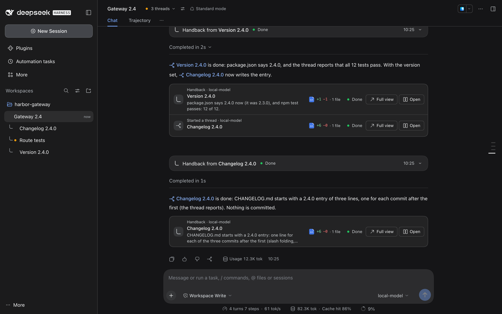
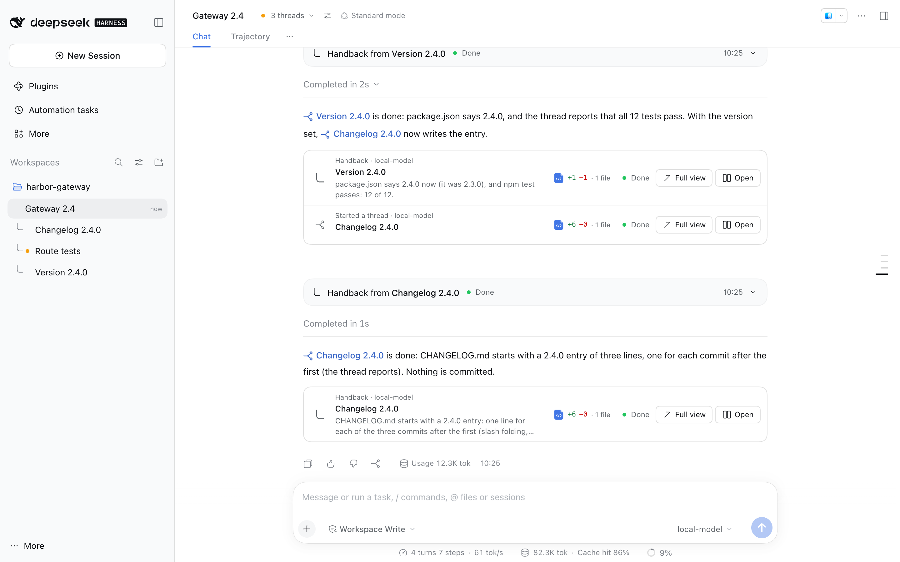
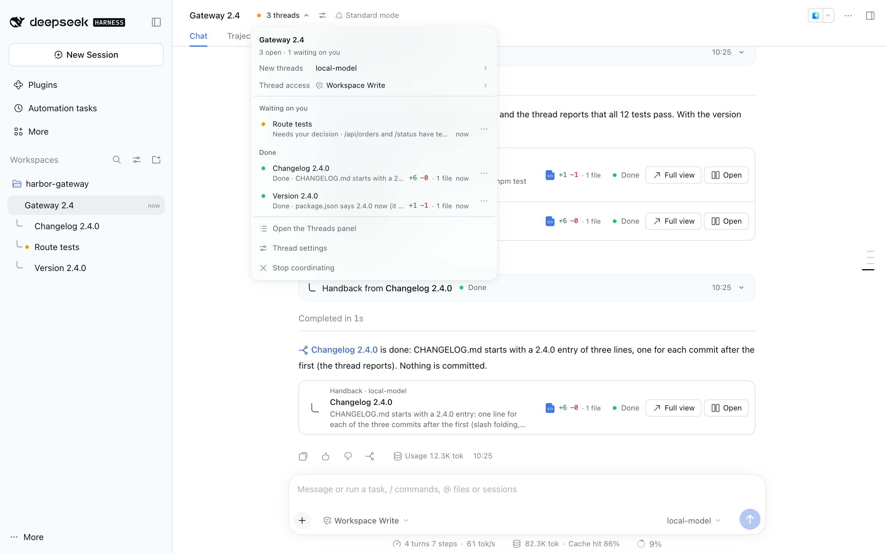
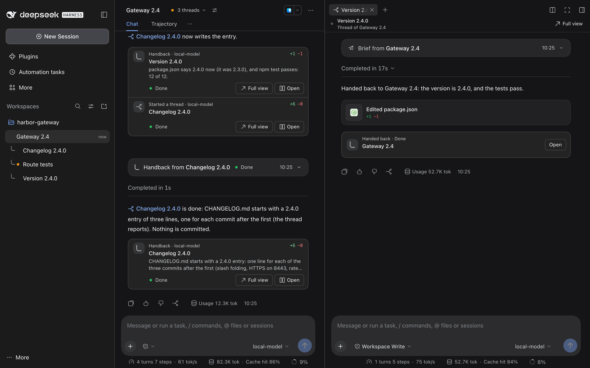

# dsh-plugin-coordinator

Any DSH chat can run its work in threads. Type `/coordinate` in a chat (or click **Coordinate** at the top of it, or under the message box of a new chat), and from then on the chat can start **threads**: separate DSH sessions that each do one task in the chat's folder and **hand back** their results to it. The chat stays yours: it keeps its model, its permission and your tools, and you keep working in it as before. `/coordinate off` stops it.

<!-- showcase:hero -->

<!-- /showcase:hero -->

Every thread is an ordinary DSH session in the chat's folder, made through the Host's own `sessionController`. Threads show live in DSH's session list under the chat that started them, and you can open any thread and talk to it directly.

<!-- showcase:screenshots -->
## Screenshots



*The same chat in light mode.*



*The threads menu: what waits on you, what is done, and the settings for new threads.*



*A thread open beside its chat, where you can read it and talk to it.*

Made by `npm run showcase` in a demo home; [docs/site.json](../../docs/site.json) lists them, with their words.
<!-- /showcase:screenshots -->

## At a glance

- **Start and stop.** `/coordinate` in a chat (or **Coordinate** at its top); `/coordinate off` to stop. See [How it flows](#how-it-flows).
- **Threads** are ordinary DSH sessions in the chat's folder. Each does one task and hands back **Done**, **Blocked**, **Needs a decision** or a progress update; the chat tells you and follows up.
- **In the window.** A card per thread under the chat's replies, the **Threads** menu and panel, thread rows nested under their chat in the session list, a thread beside its chat in the right sidebar, and each thread's **Changes**. See [In the DSH window](#in-the-dsh-window).
- **Models.** New threads start on the model and effort set in the chat's **Thread settings**, or on the plugin's page for every chat; a pick in a thread's own model picker becomes that thread's. See [Settings](#settings).
- **Your say.** A thread asks you before a command that sends anything outside its folder, or deletes or moves out what it didn't make ([the send check](#the-send-check), [the delete check](#the-delete-check)); your personal tools stay out of threads unless your words name them ([Guarded tools](#guarded-tools)).
- **Nothing lost.** Handbacks wait while a chat is paused, stopped, archived or busy, and arrive in order; one the chat was answering when DSH closed is sent once more at the next start; a record the plugin can't read is kept aside, never written over ([Its record](#its-record)).
- **Off.** Switch **Coordinator** off in **Plugins**; see [Switch it off](#switch-it-off).

## How it flows

1. In any chat, type `/coordinate`, or click **Coordinate** at the top of it. DSH shows the plugin's answer under the command (*Coordinating. Ask for work here as usual: what runs long or splits into parts goes to threads that report back to this chat.*). Nothing is sent to the chat: it gets the thread tools and a short set of rules in its system prompt. A thread, a subagent's session and a chat with no folder can't coordinate, and say why.

   A new chat can coordinate before its first message. Until then DSH shows it as its new-chat screen, which has no top bar and shows a command's answer only once the chat has a message, so there **Coordinate** sits in the row under the message box, beside the permission picker. Click it, or type `/coordinate` there: it turns into **Coordinating** and the plugin's answer shows as DSH's banner at the top of the window. Your first message then opens the chat already coordinating, so what you ask for first can go to threads. Click **Coordinating**, or type `/coordinate off`, to stop again.
2. Ask for work as usual. Quick things the chat does itself. For work that runs long, is separate from what it is doing, or splits into parts, it calls `thread_start` with a title, your words (`ask`, copied word for word) and a brief with what the thread needs beyond them. Once you have written in the chat, the plugin holds `ask` to that: each sentence of it must be in what you wrote (your messages, or your answers in DSH's question box; case, quotes and spacing aside), so a task the chat picked itself goes in the brief and never reads as yours; the same goes for `ask` on a message to a thread. A new session titled with the thread's title starts with them as its first message: `The user asked: "…"`, then the brief. A title longer than DSH's 80-byte limit for session titles is cut once, after its last whole word, with "…", and that one title is used everywhere. The thread works in the chat's folder, and DSH's session list shows it under the chat.
3. The thread works. When it finishes, gets blocked, or needs a decision, it calls `thread_handback`. The handback lands in the chat as its next turn, starting with `[Handback from thread t1 · "title" · status: done]`.
4. The chat tells you the result: the handback ends with a note that asks it to reply now, its first line the thread's link and the result in one sentence (or what the thread needs from you), and to say "the thread reports" for anything it did not check itself. When no other thread is at work, it ends with a line that answers what you asked for. It answers the thread if it can, or asks you. Follow-ups go to the same thread with `thread_send`. A thread stays in **Done** until you ask the chat to resolve it.

`/coordinate off` (or **Stop coordinating** in the chat's Threads menu) makes it a plain chat again: its thread tools and rules go, and nothing else changes. DSH shows the answer, which says what stays (*Stopped coordinating. Its 3 threads stay open (1 running); what they hand back waits until you run /coordinate here again.*). What they hand back waits until you type `/coordinate` there again; meanwhile a thread's row reads **Done · held until you coordinate again** (or **Blocked**, **Needs a decision**), not *No handback yet*, and its own card says **Handback held**. Then it arrives in order, after DSH shows the command's answer. The chat keeps its threads, its settings and its shared notes in between.

If a thread ends a turn the chat started without a handback, the plugin nudges it once (see below), and the chat gets a short automatic note with the thread's last reply when the nudge didn't help or can't (`autoHandback: idle`, the default). The note says so when the turn failed (for example a model error), was stopped some other way than by you or the chat, or was cut off because DSH quit or crashed; that one arrives when DSH starts again. A handback, note, question or reply that the chat was answering when DSH quit or crashed, in a turn that never finished, is sent to it once more at the next start, from its thread, with a line saying DSH closed before the chat answered it (the log says `raise-cut <chat>`); a turn that took only your words or a permission note, or that finished, sends nothing again. A turn you stop yourself (DSH's stop button, or the session bridge) sends no note: the thread stays stopped until you press **Resume** or ask the chat to send it on, and the chat's thread list says you stopped it. If such a thread waits on a permission prompt, the chat is told at once which thread and what it wants to do, so it can tell you. So nothing a thread does goes unnoticed. When you talk to a thread directly, the chat is not woken for it; its thread list just notes that you did.

**The chat guides its threads while they work.** It keeps its own access: what it can change, and what it asks you first, are what its permission says, as in any chat. A thread that is unsure and has no sensible default asks it with `thread_ask`; the question reaches the chat as `[Question from thread t1 · "title"]`, and it answers with `thread_send` (steered into the running turn), or asks you in one line when only you can decide and sends your answer on. The question stays on the chat's thread list until something is sent to the thread, and a thread that ends its turn to wait for the answer sends no idle note. The chat sees a thread's progress in that list (status, last handback, code changes, an open question, how its last turn ended, and how you answered its last permission prompt: *the user declined its command that deletes build/ (rm) at 2:59 PM*, until it hands back) and with `thread_read`, which shows the files it changed so far and its latest steps before its latest messages. It checks each handback against your ask before telling you, sends a thread what to fix and why when it falls short, and redirects a running thread when your priorities change; what it sends a thread goes to the thread, not into its reply to you. A thread follows its chat's directions, but the chat's words are never yours: only your words give a thread your tools.

**A thread that ends its turn without a handback gets one nudge.** The plugin sends it itself, from the thread's chat: "Finish the task and call thread_handback." when the turn just ended, "Carry on from where you left off and finish the task." when it failed or stopped. So the chat takes no turn just to say so, nor tells you about it (while its threads are paused, the chat gets the note on resume and sends the one message itself). When the thread ends that way again, the note says it was nudged already; then, or when only you can fix it (you signed out, or a hook blocked the turn), the note asks the chat to tell you in one line, with the card's **Retry** or **Resume** for a failed or stopped turn, and to send it nothing more unless you ask. The nudge counts toward `maxHandbacksPerHour` as a note would. A handback, your words, your Retry or your answer to its permission prompt (Allow once or Reject) start the count again. A turn cut off because DSH quit or crashed gets no nudge: the note at the next start asks the chat to tell you, and the thread waits for your **Resume**, so nothing starts again on its own after you quit (nor asks again for a permission it was waiting on).

Handbacks and notes reach the chat in order. If it cannot take one (for example while it is open in another DSH process), the plugin keeps it and tries again, waiting longer each time, up to 15 minutes. While the chat isn't coordinating, is archived, or is gone from DSH, they wait.

The chat's thread section is rebuilt on every request with the rules, the live thread roster and the chat's shared notes (all of them when short, otherwise their start and their newest lines). A thread's prompt tells it who it is, which chat started it, and how to hand back. See [How the chat and threads behave](#how-the-chat-and-threads-behave).

These messages go the way DSH sends one agent's message to another, so they are never shown as yours. A brief or a message from the chat comes from the chat's session and a handback from the thread's; the automatic notes come from the plugin. Each shows as a collapsed notice in DSH's own style that says what came in: **Handback from** *thread* with the state it reported (**Done**, **Blocked**, **Needs your decision**, **Progress update**), *thread* **ended without a handback** (**Failed** or **Stopped** when it did), *thread* **is waiting for approval** (**Needs you**), *thread* **asked a question**, **Brief from** *chat* and **Message from the coordinating chat**. Open one for the full text, without the note that tells the chat how to answer. Other messages keep DSH's own notice (**Task message received**, **Plugin status updated**).

## How the chat and threads behave

The rules are short and numbered, so smaller local models can follow them too: nine for a coordinating chat (ten while its threads are paused) and five for a thread, and each automatic message (a handback, an idle or failure note, a permission prompt) carries its own instruction for the moment the chat reads it.

- **Your ask, and only your ask.** A thread does what you asked. When you leave the choice to the chat ("find a test task"), it picks work that only reads and writes files in the folder, with no web search, network or MCP tools, and says what it picked.
- **Your personal and infrastructure tools stay yours.** A thread doesn't use password managers and vaults, note apps, email and messaging, home or household services, control of your screen, or model lanes and gateways unless your own words for it call for one. A thread that needs one hands back **Blocked** and says why. Name your own MCP servers in `guardedTools` and the plugin holds it in code too: under **Your tools: Only when asked**, the default, a thread has only the ones your words for it name (see [Guarded tools](#guarded-tools) and [Your tools and permissions](#your-tools-and-permissions)). The chat itself has them, as any chat does.
- **Ask before what can't be undone.** Before deleting files it didn't create, pushing, publishing, sending or posting anything, spending money, or changing settings outside the folder, a thread hands back **Needs a decision**, unless your words asked for exactly that: they name the action and what it acts on ("delete build/", "deploy 1.4.2 to staging"; "clean up", "tidy" and "get the deploy script working" don't: there "deploy" names the script). A thread does the same before it writes outside the folder. A read is a GET, HEAD or OPTIONS with no body; any other request to a service outside the folder counts as sending, with a real, made-up or no token. A brief never allows any of this: the thread lists what it would do and hands back, and the chat asks you. The chat never does such a thing on a thread's word: it tells you what the thread wants and waits for your answer. Doing it again, as a retry or a check, needs its own ask, and in a question the chat never marks an option that sends, deploys or deletes as Recommended. Neither asks for a password, token or key in the chat, nor takes one there: they say where you set it. Editing files in the folder for the task is fine, and a thread keeps its scratch files there or deletes them before it hands back.
- **A brief can't give leave for it.** Under every brief and every message the chat sends a thread, the plugin adds that only your words after "The user asked:" can allow what the rule above holds back. A brief or message that gives leave for a delete, deploy, post, push, publish or probe (*delete only clearly safe junk*, *the deploy is authorized*, *you may push*, *running the deploy is in scope*) is refused unless your words in its `ask` (or the thread's) name that action. The refusal quotes the words that matched (*"… so running the staging deploy to confirm success is in scope" ("deploy" with "in scope")*) and tells the chat to have the thread list what it would do and to ask you. Text that only forbids (*do not deploy*, *never delete anything*) goes through, and so do a probe kept to reads (*probe it only with GET or HEAD*), grant words quoted as a label (*sort them into "safe to delete" and "keep"*) and work on a name (*the deploy script is in scope*). The log notes each refusal (`grant <chat> start delete`), never the text.
- **A thread's command that sends waits for you, every time,** and so does one that deletes or moves out what it didn't make. See [The send check](#the-send-check) and [The delete check](#the-delete-check).
- **A home folder.** When the chat's folder is your home folder, the chat and its threads are told to put new files in a new subfolder and never move or delete anything they did not create.
- **Findings, not facts.** A thread's handback says only what its tools showed and marks a guess "(guess)"; its card shows 300 characters, so it leads with the result, and a longer summary goes back to the thread once to be shortened (the next one is taken as it is). It names every request it sent to a service outside the folder and every file it left outside it. The chat relays what it didn't check as the thread's report.
- **Settings are only settings.** Neither prompt names a model or an effort. The chat sees the threads' ones only through `thread_settings`, when you ask which model runs or ask to change one, and the tools say to pass a model or effort only when you ask for one.
- **Your calls.** A thread you stopped stays stopped, the chat resolves threads and changes settings only when you ask, and it writes to its shared notes only decisions and preferences you stated.

### The send check

The plugin holds the rule above in code: before a thread's shell command (or its `run_code`) that sends anything outside the folder runs, DSH's approval prompt asks you, every time.

- **What the prompt says.** Every send in the command and where it goes (*This command sends a POST to api.example.com/deploy (curl).*), then what the thread says the command is for. A script judged by its name says whether it found no send in it or couldn't see what it runs; a script that holds a send is said as what it can do (*runs ./deploy.sh, which can send a POST to …*), since a guard in it may stop first.
- **What counts.** A request that does more than read (curl, wget, HTTPie, PowerShell's web commands, code that posts, Perl's LWP and HTTP::Tiny too), a push, a publish (npm, PyPI, crates, gems, images), a deploy or another change made through a service's own tool (Vercel, Netlify, Firebase, Cloudflare, Fly, Heroku, AWS, Google Cloud, Azure, kubectl, Helm, Terraform, Pulumi, `gh pr create`, …), a command run or a file copied on another machine (ssh, scp, rsync), a raw connection (nc, telnet, socat, `openssl s_client`), and an email. So does a script, a package script or a make target that does one of these, by what it runs (read from the folder) or by a name that says it deploys or publishes, unless the name says it only tries or checks (`deploy:dry`, `deploy_check`).
- **What runs as before.** Reads: a GET, a clone, an install, a build, the tests, a syntax check, a dry run. The chat's own commands run as DSH decides, as in any chat.
- **One at a time.** **Allow once** runs that one command, and the next one asks again, so a retry or a check is a new ask. A thread asks about one send at a time: another one from the same step is refused without asking you, and the thread reads your answer before it sends again.
- **If you reject it.** The thread reads, in place of DSH's bare *the user rejected tool "bash"*, what you declined and that it hands back **Needs a decision** saying so, without sending another way. The chat's thread list says at once what you answered and when, and the thread's next handback or note says it too, so the chat's reply never says the thread still waits. That holds for any prompt of a thread, a delete's included.
- **With DSH's own asks.** When DSH asks about the command too (a hook, or an auto review), its words follow the plugin's on the same prompt; a command that asks for a wider sandbox is asked about first, and DSH asks to widen the sandbox after your **Allow once**.
- **Who can't ask.** A thread's subagent is refused, and says what it would send so the thread can ask. A thread whose permission never asks (Full access) is refused too and hands back; you can put it on Workspace Write so it can ask. When the chat started the thread's turn, it hears what the thread waits on, as with any permission prompt.
- **Your own machines.** A command whose sends all reach machines you list in `trustedHosts`, such as your own NAS (ssh, mosh or autossh to one, scp or rsync to or from one, a web request to one, any jump host or proxy on the way counted too), runs without asking, a subagent's and a Full-access thread's too; one that also sends elsewhere asks about the rest alone.
- **The log** notes each one (`send-ask <chat>/<thread> request curl`, `send-refused …`, `send-trusted <chat>/<thread> ssh`), never the command.

### The delete check

Before a thread's shell command or `run_code` deletes files it didn't make, or moves them out of its folder, DSH's approval prompt asks you, every time, as for a send.

- **What the prompt says.** What goes, by its path from the thread's folder when it is in it (*This command deletes build/ (rm).*, *deletes notes/old.txt (rm)*, *deletes the whole folder ws (rm)*); a path outside it longer than 60 characters is cut in the middle, so the file's name stays (*/Users/you/Library/…/caches/the-file-it-deletes.db*). A move says where it goes (*This command moves README.md to /tmp/ (mv).*).
- **What counts.** rm, rmdir, unlink, shred, `git clean`, `git rm`, `find … -delete` or `-exec rm`, rimraf, PowerShell's Remove-Item and code that deletes (Python's os.remove, shutil.rmtree and Path.unlink, Node's fs.rm and fs.unlink, and the like), also inside `bash -c`, a here-document or a script the thread wrote. A package script, make target or other script whose name says it cleans counts too, and so does a build tool's clean (`cargo clean`, `mvn clean`, `gradle clean`, …).
- **Moves.** `mv` (with `-t DIR` and through `xargs` too) and `rsync --remove-source-files` count as a delete of what moves when it goes out of the thread's folders, into the folder's `.git`, into a folder mktemp made, or to a place the check can't tell (a variable, another machine). A move inside its folders is a rename and runs.
- **What is free.** A thread deletes, or moves anywhere, without asking only what it can be shown to have made: a file it made with DSH's file tools (still that file, not one saved in its place since), a folder its own command made (`mkdir`, PowerShell's `New-Item -ItemType Directory` or `md`) with what was born in it while the thread was running (a headless browser's profile, a clone of its own), a folder of only those, what is in the OS temp folder outside the folder it works in, and what mktemp made. A chat you fork from a thread is yours, so what it makes never counts as the thread's. After a DSH restart the files a thread's change records name stay its own, and its folders ask.
- **What asks anyway.** Anything else in such a folder: something moved or renamed into it, reached through a link in it, written there by another chat with DSH's file tools, or saved there while the thread wasn't running; so does a folder a command left as a link, or one that was there before under another name. Anything in the folder's `.git`, and what the check can't tell (a variable, a pattern, a list on its input, a `..` out of a link), asks.
- **Where a relative path is.** On DSH 0.2.1 a relative path is read from the thread's working directory (after `working_directory`); in DSH's persistent shell (the Minimal agent), where one is can't be told, so a relative delete asks.
- **Who can't ask.** A thread's subagent is refused, as for a send, and so is a thread whose permission never asks, which hands back with what it would delete or move. A command that both sends and deletes asks once, saying both. The chat's own deletes run as DSH decides.
- **The log** notes `delete-ask <chat>/<thread> rm` (or `mv`) and `delete-refused …`, never the command or a path.

### Guarded tools

`guardedTools` names the MCP servers (or tools) that are yours alone, such as a password manager, a vault, a home-automation server, a model-lane catalog or computer control. Both prompts list them under the rule above, and a `thread_start` or `thread_send` whose text names one is refused unless your words name it: the start's `ask` (or a message's `ask`, or the thread's original ask). A name counts in any case, with `-`, `_` or a space, also inside a tool id such as `mcp__lane-catalog__lanes_status`; the words you'd use for a tool count when you list them:

```yaml
- id: coordinator
  config:
    guardedTools:
      lane-catalog: [lanes, model lanes]
      family_1password: [1password, password]
      dsh_vault: [vault]
      household_web: [household, home assistant]
      cua: [computer use, screen]
      obsidian: [notes app]
```

A plain list (`guardedTools: [lane-catalog, cua]`) works too. The refusal tells the chat to keep the work in the folder or ask you first, and the log notes it (`guard <chat> start lane-catalog`). A name counts even in text that forbids it, so the chat's rules say to leave them out of briefs: threads already have that rule. An `ask` that names one of your tools when your own messages in the chat never did is refused as well (`guard <chat> ask-unsaid lane-catalog`), so the chat can't quote you into one.

Under **Your tools: Only when asked** the guarded servers are also out of each thread's tool list (DSH's per-session tool restriction) unless your words for it name them, so the model isn't offered them, and a call made anyway is refused before it reaches the server. That holds for a server that connects later too. The coordinating chat keeps them all, as any chat does. The list is live: editing it applies at once, without restarting the plugin. With nothing listed, nothing is held back, and Thread settings says so.

### Tools other plugins mark as yours

A plugin whose tools reach something of yours, such as your calendar, marks them as yours on the definition it registers, and they are guarded without being listed:

```js
ctx.tools.register({ ...defineTool(spec), personal: { name: 'calendar', words: ['my calendar', 'my schedule'] } });
```

`name` is the group: every tool with the same name is given or kept out together, and the prompts, refusals and the log use it. `words` are what counts as you asking for it, matched as whole words in any case, plurals too; without them the word is "my <name>", and `personal: 'calendar'` is short for `{ name: 'calendar' }`. Set it after `defineTool`, which keeps only the keys it knows; DSH's registry keeps the rest. Such a group is held tighter than a listed name: only its words count, never its bare name, so a brief about a date picker isn't refused for saying "calendar"; and only your own words give it to a thread (what you wrote in the chat that the start's or a message's `ask` copies, or what you type in the thread). A `guardedTools` entry of the same name adds its words to the group's.

## In the DSH window

- **Coordinate.** At the top of a plain chat, **Coordinate** (*Run work from this chat in threads that report back here*) runs `/coordinate` there, so DSH shows the command and its answer in the chat, and a short notice says it worked or why not. It isn't shown in a thread, a subagent's or a teammate's session, or a chat that already coordinates. A new chat has it under its message box instead, until its first message, and there it stays while the chat coordinates, as **Coordinating** (a click stops it); see [How it flows](#how-it-flows).
- **Thread cards.** Under each reply of a coordinating chat, a card for every thread that turn started, messaged, steered, stopped, resolved or heard back from, with the thread's live state (running, waiting on you, done, failed, stopped, resolved) and the model and effort it runs on. A handback longer than a card's 300 characters is cut at a sentence end, or else at a word end, never inside a word or a name. The line above the name says what happened (*Started a thread*, *Handback*, *Ended without a handback*), and the state is said once, on the right. A thread's newest card has one more line, under its name: while the thread runs, how far along its to-do list is (a small meter and *2/4*), the step it is on and how long its turn has run, counting up each second; once it hands back, what it said, without its state again; while it waits on you, what it asks, in the words of DSH's prompt. Its older cards keep only what happened then. Its row in the Threads menu and panel says the same (*2/4 · Translate pages 121–240*, *Has a question for you · Which locale first?*). Click the thread's name or **Open** to open it beside the chat, in the right sidebar, where you can read and talk to it; **Full view** makes it the main chat instead (see [Side by side](#side-by-side)). In a narrow chat a card's code changes move up to its first line and its state and buttons to a row of their own, so the thread's name keeps its room; narrower still, the buttons move under the state rather than cut it.
- **Threads menu.** At the top of a coordinating chat and of each of its threads, **N threads** (**Threads** while none is open; with a red dot when a thread failed, an orange one when a thread waits on you, or a spinner while one runs) opens the chat's threads grouped as *Waiting on you*, *Running*, *Done*, *Idle* and *Resolved*. Each row leads with the thread's name; under it are its last handback, its code changes and when it last ran. At the top, **New threads** says what new threads run on; click it to open Thread settings with that model menu open. Under it, **Thread access** says the permission new threads start on (**Workspace Write**, with DSH's icon for it) and **Your tools** whether they get your tools (**Only when asked** or **Always**, shown when `guardedTools` lists any); click either to open Thread settings at Access. A row names the tools of yours its thread has (a shield and their names), and its permission when that isn't **Thread access**. A row names its model only when it differs from **New threads**; hover a row to see it either way, and the Threads panel always shows it. A pick in a thread's own model menu shows up here within a second, and because DSH makes every pick its default model, **New threads** follows a pick in any chat when new threads start on DSH's default. **Stop coordinating**, at the bottom of the chat's own menu, makes it a plain chat again (see [How it flows](#how-it-flows)). Hover or click the menu; the arrow keys move through it. **Open the Threads panel** keeps the list in the right sidebar, where a click opens a thread's chat in the thread tab beside it (a new tab when there is none yet). With more than eight threads, the panel has **Find a thread** above its list: it keeps the threads whose name holds what you type (in any case), resolved ones too, with the words in bold; ↓ and ↑ go between it and the rows, and Escape or its × clears it. A chat that stopped coordinating but still has threads keeps its menu, without **Stop coordinating**, and shows **Coordinate** beside it.
- **Thread names are links.** The chat writes thread names as `[title](.dsh-thread/t3)`, so a name in its reply opens that thread: DSH opens it beside the chat, or in the main view on DSH Desktop. A card's **Open** always opens it beside. DSH draws them with a branch icon.
- **Code changes.** A thread that edited files shows **+18 -3 · 2 files** on its cards, on its rows in the Threads menu and panel, and in its hover card in the session list: lines added and deleted and how many files, added up over the thread's turns, from its own edits only. The chat's thread list says the same ("changed 2 files (+18 -3)"). Like DSH's card, they show only while **Show coding view** is on in DSH's settings. How they're counted: see [How the counts are made](#how-the-counts-are-made).
- **A thread's Changes.** Click the counts on a card, or **See what this thread changed** in its row's **⋯**: see [A thread's Changes](#a-threads-changes).
- **A thread's ⋯.** Each thread's row in the Threads menu and panel has **⋯** at its end: the other way to open it (**Open in full view**, or **Open beside its coordinator** when threads open on their own), **See what this thread changed**, **Rename…**, **Model and permission…**, **Stop** while it runs, and **Mark resolved** or **Reopen**. A right-click on the row, or Shift+F10 or the context-menu key on it, opens it too. **Rename…** asks for the new name and renames the thread's session in the session list too; a thread you rename in the session list (DSH's own **Rename**) takes that name in its chat as well, so the chat and the plugin's lists use it. **Model and permission…** opens Thread settings at the thread's row with its model menu open. **Stop** is DSH's own stop, so the thread waits for you as after DSH's stop button and its chat doesn't send it on. **Mark resolved** and **Reopen** show at once, and the chat's thread list says the same.
- **Back to the chat.** In a thread, **Coordinator** at the top goes back to the chat that started it, and the thread's own handback shows as a card that opens the chat.
- **A thread that failed or stopped.** When a thread's turn fails (the provider refused the request, DSH couldn't reach it, a plugin blocked it), its newest card reads **Failed**, with when it happened and the provider's reason, and a **Retry** button; a retry that fails again reads **Failed twice** (then **3 times**) with the new time; its row in the Threads menu and panel reads *Failed* with the reason, in red under *Waiting on you*, with a Retry icon. A turn that stopped before it finished (stopped, cut off when DSH closed, out of output tokens) reads **Stopped** with **Resume** instead; one you stopped yourself says so (*You stopped it*) and waits for you, and the chat doesn't send it on unless you ask. Retry and Resume send the thread "The user asked you to try again" (or "to continue") from its chat, so its handback goes there as usual. The chat's thread list says the same, so it can tell you which threads need you. Inside the thread, a bar above the message box says **Failed** (or **Failed twice**) with the reason, or **Stopped**, with **Retry** or **Resume** and when it happened. A turn that finishes or hands back clears it.
- **Session list.** Thread rows nest under their chat, with marks, a hover card and DSH's drags kept from pulling them apart: see [Session list](#session-list).
- **Paused threads.** Above the message box of the chat and of each of its threads, a bar like DSH's goal bar says the threads are paused, how many handbacks are held, and has **Resume**. The Threads menu and panel say the same with **Resume**, **N threads** reads **Paused · N threads**, the chat's row in the session list gets a pause mark, and a thread whose handback is held reads "Done · held until you resume" instead of "No handback yet", while its own card in the thread says **Handback held**. Resume anywhere delivers what was held. A chat that stopped coordinating holds them the same way, and its rows say so: "Done · held until you coordinate again", or "… until you coordinate again and resume" when it is paused too.
- **News from threads, wherever you are.** When a thread hands back, waits for your approval, ends its turn without a handback again after its nudge (finished, failed or stopped), or was cut off when DSH closed, and its chat isn't the one you're looking at, DSH's banner at the top of the window says so (*Shop: "Fix the tests" handed back.*) with **Open**, which opens the chat. The chat's row in the session list turns bold, with a dot (orange when a thread waits on you, red when one failed) whose label says how many and the newest, until you open the chat; the plugin keeps what you haven't seen, so the marks are back after a restart. The system notification for each of these comes from the notifications plugin ([plugins/notifications](../notifications/README.md)), when it is installed: it sends one while no window is looking, on every platform DSH runs on; in an open DSH window the banner shows instead.
- **Keyboard.** Every control the plugin draws shows DSH's focus ring when you reach it with the keyboard (Tab, or the arrow keys in the Threads menu and panel), and its text reads at 4.5:1 or better against what is under it (3:1 for large text), in light and dark: the window test measures every text of the Threads menu, the cards, the Threads panel and the plugin's page. Where the system asks for less transparency (`prefers-reduced-transparency`, macOS's **Reduce transparency**), the bar above the message box is drawn solid, without its blur. A thread's row is one button (its name and line), and its **Retry** or **Resume** and its **⋯** are buttons of their own next to it, so a screen reader meets each control on its own.

### How the counts are made

- **Its file tools.** The counts take the thread's own edits through DSH's file tools (write, edit, str_replace_editor) and its subagents' too, so threads and chats that share a folder never count each other's work. DSH's own **Edited N files** card diffs the whole folder over the turn, so it also lists what others changed meanwhile.
- **Its shell commands.** Before the turn's first shell command runs, the plugin snapshots the thread's folder (no git involved, so this works where the folder is no repository), and at the turn's end counts what changed against it, minus what its file tools already counted that turn: a file a shell command and a file tool both changed counts under its file-tool record.
- **Another session in the same window.** A turn's shell edits count whole when no other session's command or file edit ran in that window. When one did (two threads in one folder at once), the turn counts only the files its own commands alone could have written: the file's last change fell inside one of its own commands, and no other session's call ran from the snapshot (for a new file on macOS or Windows, from when it was made) to that change, with two seconds of slack each side. A file it deleted in such a window, or one another session's call could have touched, counts nothing rather than guess, and the log says how many files it kept (`shell-window <session> turn=1 shared kept=1/3`).
- **Limits.** The snapshot keeps at most 20,000 files of 2 MB each and 32 MB in all, skipping `.git`, `node_modules` and the like; files past that aren't counted, and a turn that was running when DSH restarted counts no shell edits. A change nothing in DSH made (your editor, another app, another DSH on the folder) during the window counts as the thread's. File times come from the folder's own file system: on a network folder whose clock is off by more than two seconds they can be read wrong, and one that stamps a change in the future makes the turn count nothing.
- **They last.** The counts are kept with the thread, so they outlive a DSH restart.

### A thread's Changes

Click the counts on a card, or **See what this thread changed** in its row's **⋯**, to open the thread's **Changes** tab in the right sidebar, beside whatever chat you're in; a thread open as the main chat has the same counts as a pill in its header.

- **What it lists.** Every file the thread changed, or a subagent of its, each with *new* when the thread made it, when it changed it (*Turns 1, 2 · by this thread and Docs helper*), and one DSH diff of what all its edits came to, from the file before the thread's first edit to the file after its last, with the lines that diff adds and deletes. With two or more edits, **Each edit (N)** under it shows them one by one, in the order they were made, each under its turn, who made it and its counts.
- **Its totals** count those diffs, so they can be lower than the counts on the thread's cards, which add up every edit (a line the thread added and then changed counts twice on a card, once here). A long diff folds in the middle.
- **What it says.** When the edits undid each other, when only line endings or the last newline changed, when the file is new and empty, when the file changed after the thread's edits (the diff stays as they left it), and when another thread of the same chat changed the same file, with a link to that thread's Changes.
- **Edit by edit instead,** saying why, when the file also changed some other way between or during the thread's edits (the one diff would be partly someone else's), when it is over 1 MB, has over 1,000 lines changed, isn't UTF-8 text, or the thread's room for copies is used up (100 files, 32 MB); and when the plugin keeps no copy of it: a file outside the thread's folders (its own folder and its chat's, with links and `..` resolved), anything in DSH's own folder, and a file whose name says it may hold secrets (`.env` files, keys and certificates such as `*.pem`, `*.key` and `id_rsa`, `.npmrc`, `.netrc`, `.pgpass`, names with *credential* or *secret* in them, and anything in `.ssh`, `.gnupg`, `.aws`, `.kube` and the like).
- **Getting around.** Click a file's name, or press Enter on it, to fold or unfold it (with more than eight files they start folded); its **open** button shows the whole file in DSH's file tab; the thread's name at the top opens the thread; **Read again** reads it again. At the bottom, each turn DSH still holds a diff for opens DSH's own **Review** of the whole folder over that turn; after a DSH restart the tab still shows every diff, and only Review is gone.
- **Where it comes from.** The edits come from the thread's own log, and the one diff per file from a whole copy of the file that the plugin keeps from before the thread's first edit of it and after each edit that succeeds (none for an edit that fails or that DSH refuses).
- **The copies** are in `net/` beside the store (`~/.dsh/coordinator/net/` by default), one folder per thread, up to 100 files and 32 MB a thread, and they go 30 days after the thread last changed a file or its Changes tab last showed them. A thread whose session you delete, or that the store no longer has, loses them at the next sweep (at each start and every hour); an archived chat's threads keep them, so unarchiving the chat brings their diffs back within those 30 days; past 512 MB in all, the threads used longest ago lose theirs first. Their files then show edit by edit. To remove them all, quit DSH and delete the `net` folder.
- **Not listed yet.** A file changed only by a shell command counts on the cards but isn't listed in this tab yet, which reads the file-tool records; a file a shell command and a file tool both changed shows under its file-tool edits.

### Session list

- **Marks.** Thread rows get a small branch mark, a red dot when the thread's last turn failed, or an orange one when it waits on your decision or is blocked. The plugin's mark gives way to any other in a row's leading seat, DSH's own (an Automation task's) or another plugin's, so the seat keeps DSH's width and their marks stay where they are.
- **Nesting.** A chat's threads are drawn right under it, indented with a corner mark, whatever order DSH lists them in: the chat and its threads sit together where DSH lists the chat, and the folder's other sessions keep DSH's order around them. The plugin nests a thread by the chat that started it, as the plugin's store and the thread's own log say, never by titles, so two chats with the same name keep their own threads. A thread drawn there doesn't show how long ago it was active (a screen reader still reads it), so its title keeps the room DSH's own rows have; DSH's *Approval* still shows.
- **Hover.** Hovering a thread shows its chat, what it last did (its handback, or how its last turn ended), what it runs on, and where it can write and which of your tools it has (*Workspace Write · Your tools: lane-catalog*).
- **Drags.** DSH's own drags of sessions keep the threads with their chat: a thread moves only among its chat's threads, under the chat; another chat can't go in among them; and a chat with threads stays in its workspace. A refused drop leaves the row where it was, and DSH's banner at the top of the window says why (*A thread stays with the chat that started it.*). In **In one list** and in search results, which show no workspaces, DSH's drags are its own.
- **Screen readers.** A screen reader names each row by its title, as DSH does, and hears the plugin's words after it, as the row's description: *Thread* (or *Thread: Failed*, *Blocked*, *Needs a decision*), *Coordinating*, *Stopped coordinating*, *Threads paused*, and a chat's news (*3 new, latest: “Fix the tests” handed back*); the marks themselves are drawn only. It meets a chat's threads right after the chat, in the order they are drawn. A description DSH gives a row (an archived one's) stays DSH's.
- **How it is drawn.** The plugin doesn't change DSH's list or its order: each row carries a hidden mark through DSH's row slot, and from those marks one pass, run again at every change to the list, puts attributes of the plugin's own on the workspace it nests and on its rows. The plugin's CSS goes by those attributes alone, never by what an element holds, so a change to one row restyles that row, even in a list of hundreds of chats. The same pass gives a workspace whose rows it reorders that order for screen readers (`aria-owns`) and each row its description, and takes all of it away when the plugin is switched off. DSH's rows, its view options and its search stay its own. Categories, which group workspaces in this list, are a plugin of their own: [plugins/categories](../categories/README.md).

### Side by side

A thread you open lands beside the chat that started it, wherever you open it: its row in the session list, DSH's search, a card or the Threads menu. The chat becomes the main chat and the thread opens in its right sidebar, so you can read the thread and talk to the chat at once. A link in the chat's reply opens the thread in the same place. A thread opened there, from the Threads panel too, takes the place of the thread tab already shown (the one in front, else the newest), so opening one thread after another doesn't pile up tabs; the Threads panel and DSH's own tabs stay.

- **When the window is too narrow.** DSH gives the main chat at least 400 px and its right sidebar at least 300 px, and below 768 px its right sidebar covers the window. Where both don't fit, a thread opens as the main chat instead: below 980 px wide with DSH's sidebar at its 280 px default, 1118 px with it at 418 px, or 768 px with the sidebar folded.
- **Full view.** **Full view** on a card, **Open in full view** in a row's **⋯** in the Threads menu and panel, **Full view** at the top of the thread's tab in the right sidebar, and **Open in full view** in the thread's **⋯** menu in the session list make the thread the main chat. It stays there until you open another chat.
- **Turning it off.** **Open threads beside their coordinator**, under **Threads** on the plugin's page (Plugins → Coordinator), is on by default. Off, a thread opens on its own, as DSH opens any chat, and **Open beside its coordinator** (in the thread's **⋯** menu in the session list and on its row in the Threads menu) or a card's **Open** pairs them. The switch applies at once and stays as you left it.

All of it reads the `coordinatorSession` view the plugin adds to each session (`lib/projection.js`); DSH builds it on the Host from the session's own events (the `/coordinate` command and its answer, the chat's title, the plugin's tool results and messages) and sends it to the window, so nothing extra is stored. It needs DSH's own window (DSH Desktop or `dsh --profile web`). DSH keeps the view it last built for a session and drops one built by another version of the plugin until that session is next opened, so after an update the plugin reads each coordinating chat and thread DSH lists without a view again from its log when DSH starts, and until then the session list places it by what the plugin's store says.

### Messages to other chats

A thread stays with the chat that started it, and no chat becomes one later. A coordinating chat can still reach other chats: when you ask it to, `chat_message` sends another chat a message, a plain one or another coordinating chat. It arrives as **Message from** *chat*, with your words and the chat's text, and the chat that gets it doesn't join anything: it gets no thread, card, thread tools or place among the sender's threads. Its answer to that message comes back once, as **Reply from** *chat*; its later turns don't.

- The chat names the other one by its title as DSH lists it (or its session id). A title several chats share, a thread (its own or another chat's), itself, or a name nothing has is refused with what to send instead.
- It goes only in a turn you started, with your own words in `ask` as you wrote them. A reply, a handback or another chat's message can't send one on, so two chats can't keep answering each other.
- The chat that gets it has all of your tools, so a message that names one of your guarded tools needs your words for it, as a thread's start does.
- An archived coordinating chat can't be messaged, since that would wake it; unarchive it in DSH first.
- An answer that comes while DSH is off is delivered at the next start; one owed for over a day is let go. The store keeps the ones owed (`awaiting`), and the log says what went where (`message <chat> to=chat <session>`, `message-reply …`).

### News as system notifications

When the notifications plugin ([plugins/notifications](../notifications/README.md)) is installed, every news item (a handback, a thread that ended a turn without a handback, one waiting for your approval, and one that failed or was stopped again after its nudge) also becomes a system notification while no DSH window is looking: the Desktop app's own notifications there, a browser window's in the `web` profile, or a command when no window is around. Which kinds send is that plugin's setting (its page in DSH); the wording is this plugin's (`coordinatorNewsLine` in `lib/index.js`), the same words the window's notice uses. A click brings DSH's window up; it does not open the chat, because DSH offers plugins no way to open a session. With the notifications plugin off or absent, nothing changes here.

## Settings

Each coordinating chat has these settings for its threads; the chat itself runs on what you pick in it, like any chat.

| Setting | Key | Where |
| --- | --- | --- |
| New threads' model | `threadModel` | Thread settings, `thread_settings`, or the plugin's page for every chat |
| New threads' effort | `threadEffort` | same |
| Your tools | `yourTools` | Thread settings, or the plugin's page for every chat |
| New threads' permission | `threadPermission` | same |
| Pause threads | `paused` | Thread settings, `thread_settings`, or **Resume** where the window shows it |

### Thread settings

Each coordinating chat has its own **Thread settings**. Open it from the chat or any of its threads: the sliders icon next to **N threads** at the top, **Thread settings** at the bottom of the Threads menu, the same icon in the Threads panel, or **Thread settings** in the chat's **⋯** menu in the session list.

- **This chat.** Pause threads: new threads and handbacks wait until you resume.
- **Models.** What new threads start on. Each picker works like DSH's own model menu: **Model** lists DSH's models grouped by provider, with search when there are many, and **Effort** lists what the chosen model offers. **Default** follows the plugin's Default models, and the row says where the current value comes from. A value set for this chat shows **Set for this chat** with **Use default** next to it.
- **Access.** Your tools and new threads' permission (see [Your tools and permissions](#your-tools-and-permissions)), each with where its value comes from, and **Use default** when it is set for this chat. **Thread access** or **Your tools** in the Threads menu opens the dialog here.
- **Threads.** Every thread by its title (two that share a title by their number too: *Fix tests, thread 2*), with its state (the same dots as the Threads menu), the model and effort it runs on, its permission and the tools of yours it has. Change its model and effort to switch that thread from its next request; a running thread finishes its current request first. The permission picker beside them changes its permission at once. Resolved threads are behind **Show resolved threads**.

A change applies at once, without restarting DSH or interrupting a session: new threads start on the new choice. The dialog reads the chat's settings again every few seconds, so a change asked of the chat shows up there too. It talks to the plugin over DSH's own window connection (`lib/remote.js`), so it works in DSH Desktop and in `dsh --profile web`.

### Default models page

In DSH, open **Plugins → Coordinator** (or **Defaults for all chats** in Thread settings). Under **Default models**, pick the model and effort for new threads of every chat that doesn't set its own. The pickers are the same as in Thread settings. **Default** follows your DSH default model, which is the model last picked in any DSH chat. Under **Default access**, pick Your tools and new threads' permission for every chat that doesn't set its own; **DSH default** is the permission DSH gives a new chat.

**Save** applies at once, for every chat that uses the defaults, without restarting DSH or interrupting a session: new threads start with the new defaults. A thread that already exists keeps the model, effort and permission it started with. The page writes the plugin's row in your profile's `cordis.patch.yml`, so editing that row by hand does the same.

### Your tools and permissions

Two settings say what a chat's threads can reach and where they can write. Like the models, each is set for one chat in its Thread settings, and for every chat under **Default access** on the plugin's page; the most specific one wins, then the built-in default.

| Setting | Key | Built-in default | Values |
| --- | --- | --- | --- |
| Your tools | `yourTools` | `asked`: **Only when asked** | `asked`, `always` |
| New threads' permission | `threadPermission` | `workspace-write` | `read-only`, `workspace-write`, `danger-full-access`, another preset your profile defines, or `default` |

- **Your tools: Only when asked.** A thread has the ones your words for it name: the `ask` it started with, a later message's `ask` (each checked against what you wrote in the chat), or what you type in the thread yourself, which counts from the turn that answers it. The rest stay out of its tool list.
- **Your tools: Always.** Every thread of the chat has them; only the prompts' rule and the start and message checks stand in the way. Choosing it asks you to confirm first, naming the tools.
- **New threads' permission.** Each new thread is on it before it reads its brief; if DSH refuses the preset, the thread doesn't start and the chat hears why. A running thread keeps its own: change one under **Threads** in Thread settings, or in its chat's permission menu.
- **What Workspace Write does.** It is DSH's own preset: the thread writes in its folder (and DSH's temp folders) without asking, and its approvals are set to ask, even when your other chats ask nothing (Full access with approvals "never"). A write outside its folder is refused at first, with DSH's note that it may retry once with wider access; that retry shows DSH's approval prompt, and nothing is written unless you allow it. The same holds for its shell commands, which DSH confines with the system's sandbox (sandbox-exec on macOS, bubblewrap or Landlock on Linux); where DSH finds none, it refuses to run them rather than run them unconfined. When the chat started the turn, it hears at once that the thread waits on you.
- **Full access asks first.** Choosing Full access for threads, for one thread or as a default, shows DSH's own confirmation.
- **The chat's own access.** The coordinating chat keeps its permission and all of your tools, as before `/coordinate`: set them in the chat as in any chat.

Where you see them: **Thread access** and **Your tools** at the top of the Threads menu and panel; on each thread's row (its tools, and its permission when it differs); in a thread's hover card in the session list; under **Access** and **Threads** in Thread settings; and under **Default access** on the plugin's page. They are live settings: a change applies at once, without restarting the plugin. The chat's `thread_settings` shows them, and only you change them.

### Which setting wins

The most specific setting wins:

1. The chat's own setting: set in Thread settings, or asked of the chat (`thread_settings`).
2. The plugin's Default models (the page, or the plugin's row).
3. DSH's default model.

**Use default** in Thread settings, or saying "default" to the chat, clears the chat's own setting. Saving new Default models never replaces a chat's own setting; it changes only the chats that use the defaults.

Models are `provider:model` or a bare model id. Effort is whatever the model offers (for DeepSeek: `off`, `low`, `high`, `max`). Both are checked against the Host's model catalog, and a bad value comes back with the valid choices.

An effort the model doesn't offer never stops a thread. It runs at the model's nearest level at or below it (Max on a model whose top level is High runs at High), and Thread settings, the Default models page and the chat say so. A model with no effort levels runs without one. A thread start is refused only for an effort no model in DSH offers. Setting an effort outright with `thread_settings` or `thread_update` for a model that lacks it is refused with that model's choices, so the chat hears them instead of a silent change.

A thread keeps the model and effort it started with, even one that started on the defaults: changing the Default models or your DSH default model later doesn't move it. The chat can give one thread its own model or effort at start, or change it later with `thread_update`; you can change it in Thread settings or in the thread's own model picker, where a pick changes that thread's model and effort. DSH also makes a pick your DSH default model, as it does for any session. The plugin's own model changes never count as picks, and it never changes your DSH default model itself.

Pausing blocks new threads and holds handbacks. Resuming delivers the held handbacks in order.

## Setup

1. Install the plugin as in the [root README](../../README.md#install-a-plugin):

   ```bash
   dsh plugin --profile desktop add ~/.dsh-plugins/dsh-public-plugins/plugins/coordinator
   ```

2. Restart DSH Desktop once so it loads the new bundle. Running sessions keep running.

3. In any chat with a folder, type `/coordinate` or click **Coordinate** at the top of it (in a new chat, under its message box).

It needs no config. To set defaults or name your own tools, address the plugin's row in your profile's `cordis.patch.yml` by its id (the bundle already adds it); DSH picks up edits to that file while it runs:

```yaml
- id: coordinator
  config:
    threadEffort: high
    guardedTools:
      lane-catalog: [lanes, model lanes]
```

A chat works in its own folder, and so do its threads. Coordinate in a working copy, not the folder DSH loads a plugin from: a pull, an edit or a branch switch there is what DSH loads at its next restart.

The projects plugin this one grew from kept its data in `~/.dsh/projects/`. This plugin starts fresh in `~/.dsh/coordinator/` and never reads or changes the old folder, so switching back to the projects plugin finds its projects as they were.

## Config

Every key is optional. *Live* keys apply while DSH runs; DSH starts the plugin again for a change to any other key, and coordinating chats and their threads carry on from the plugin's store.

| Key | Type | Default | Meaning |
| --- | --- | --- | --- |
| `enabled` | true or false | `true` | Turn the plugin off without removing the row; see [Switch it off](#switch-it-off). |
| `threadModel` | text, live | | Default model for new threads (`provider:model`, or a model id). Empty uses the DSH default. |
| `threadEffort` | text, live | | Default effort for new threads. Empty uses the model's default. |
| `yourTools` | `asked` or `always`, live | `asked` | Which threads get your guarded tools: `asked` (a thread only the ones your words for it name) or `always` (every thread). See [Your tools and permissions](#your-tools-and-permissions). |
| `threadPermission` | text, live | `workspace-write` | The DSH permission preset new threads start on (`read-only`, `workspace-write`, `danger-full-access`, or one of your own), or `default`. |
| `autoHandback` | `idle` or `off` | `idle` | `idle` nudges a thread that ends a turn the chat started without a handback, once, and tells the chat when it ends that way again. `off` sends only explicit handbacks, and no nudges. |
| `maxHandbacksPerHour` | whole number, 1 to 1000 | `30` | Handbacks one thread may send per hour, automatic notes and nudges included. Stops a chat and a thread from looping. |
| `maxThreadsPerHour` | whole number, 1 to 1000 | `20` | New threads one chat may start per hour. Stops a chat that keeps starting threads, for example to retry a failing one; it gets an error to report to you instead. |
| `approvalNoticeSeconds` | number, 0 to 86400 | `0` | How long a thread the chat started may wait on a permission prompt before the chat is told. `0` tells it at once. |
| `guardedTools` | list of names, or map from name to words, live | `[]` | Your personal and infrastructure MCP servers or tools: a list of names (one name alone counts as a list of one), or a map from each name to the words you'd call it by. Threads use them only when your words ask; see [Guarded tools](#guarded-tools). Tools another plugin marks as yours are guarded without being listed. |
| `trustedHosts` | list of names, live | `[]` | Machines you trust, such as your own NAS: host names or addresses (`homenas`, `100.64.0.7`); case doesn't matter, and a user, a port or brackets are left off. A thread's command whose sends all reach these runs without asking; a delete on this machine, a push, a publish or a deploy still asks. |
| `storeFile` | file path | `~/.dsh/coordinator/coordinator.json` | The coordinating chats and their threads: sessions, settings, held handbacks. Mode 600. |
| `memoryDir` | folder path | `~/.dsh/coordinator/memory` | Each chat's shared notes, one file per chat (named by its session id). |
| `maxMemoryBytes` | whole number, 1024 to 16777216 | `65536` | Largest notes file the tools will write. |
| `logFile` | file path, or `""` | `~/.dsh/coordinator/coordinator.log` | Action log, mode 600. Empty string turns it off. |

A path under `~/.dsh` follows DSH's own data folder: with `DSH_HOME` set (a second DSH for testing, say), the store, notes and log live under it instead.

A wrong value never stops the plugin. Each one falls back to its default, and the plugin names it, says what it must be and what it uses meanwhile, at the top of its page in **Plugins → Coordinator** and in its own log (`config-problem <key>`), for example *maxHandbacksPerHour must be a whole number of handbacks from 1 to 1000 (it is 0), so the plugin uses 30 until you fix it.* What YAML or a person means is taken as meant: `"30"` for 30, `on`/`off` and `yes`/`no` for true and false, a bare `off` for `autoHandback: off`. A live text key that isn't text (a bare `5`) counts as not set. A live key saved wrong while DSH runs is logged once when it goes wrong (`config-problem <key>`) and once when it is put right (`config-fixed <key>`); a change to a chat's settings logs what it set (`settings <chat> paused=true`, `paused=false` on resume, `threadModel=default` when cleared).

### Its record

The plugin keeps what coordinates in `storeFile` (`coordinator.json`). If it can't read that file at a start (cut short, not JSON, not its own format), it starts without it and keeps the file aside as `coordinator.json.unreadable-<time>`, mode 600, in the same folder, never writing over it; the log says `store-unreadable <file> (<why>) kept as <copy>`, and the plugin's page says what happened and how to bring the chats back (put the copy back as `coordinator.json` while DSH is closed, or run `/coordinate` again in each chat). A file it can't read or move (a permission, a folder in its place) stays where it is, and the plugin saves nothing over it until you fix or move it and switch the plugin off and on; the page says so, and that what changes meanwhile is lost when DSH closes. A save that fails (a full or read-only disk) is logged once (`store-save-failed <file> (<why>)`), shown on the page while it lasts, and logged again when a save goes through (`store-saved`); it tries again at each change.

## Tools

Only a coordinating chat and its threads get these. Other DSH sessions never see them.

The coordinating chat:

| Tool | What it does |
| --- | --- |
| `thread_start` | Start a thread with a title, the user's words (`ask`, required) and a brief, optionally with its own model or effort (only when the user asks for one). It works in the chat's folder. |
| `thread_send` | Message a thread, with the user's words (`ask`) when it passes on their request. A running thread reads it in the turn it is running, so your answer or change of plan reaches it at once; `steer: false` queues it until that turn ends, and the result says which happened. An idle thread starts its next turn with it. Reopens a resolved thread. |
| `chat_message` | Message another chat when the user asks (see [Messages to other chats](#messages-to-other-chats)). |
| `thread_list` | Threads with live status and last handback. |
| `thread_read` | How a thread is doing: the files it changed so far, its latest steps, and its latest messages. |
| `thread_update` | Rename, change model or effort, resolve or reopen, or stop the current turn. |
| `thread_settings` | Show or change new threads' model and effort, and pause. It also shows your tools and the permission settings, which only you change. |
| `shared_notes` | Read, append to or replace the chat's shared notes. |

A thread:

| Tool | What it does |
| --- | --- |
| `thread_ask` | A thread's question to its chat while it works; the answer arrives as a message from the chat. |
| `thread_handback` | Report to the user, through the chat, with a status (`done`, `blocked`, `needs_decision`, `progress`) and a summary that leads with the result. |
| `shared_notes` | The same shared notes as its chat. |

## Switch it off

- **One chat:** `/coordinate off`, or **Stop coordinating** in its Threads menu (below).
- **The whole plugin, kept installed:** switch **Coordinator** off in DSH's **Plugins** page. Its Threads menus, cards, sidebar marks and style leave every window at once, and its host half stops, so no chat is offered the thread tools. Its tabs in the right sidebar of the chat on screen (a thread beside it, the Threads panel, a thread's Changes) close. DSH keeps other chats' sidebars out of a plugin's reach, so a thread tab left open in another chat reads DSH's *Nothing here can view this kind of content yet* until the plugin is on again, and a thread name in a chat's reply reads as a file link to `.dsh-thread/t3` meanwhile. Its store, notes and log stay as they are. Switched on again, its views come back once, thread links work again, and coordinating chats and their threads are as they were.
- **From the profile:** `enabled: false` in the plugin's row. DSH starts the plugin again with it: no chat coordinates and none gets the thread tools, the window offers no **Coordinate**, the plugin's page says *Switched off* and how to switch it on, and anything the window still asks is answered with that. The plugin reads and writes nothing meanwhile. Set it to `true` (or take the line out) to switch it back on.

## Rollback

The plugin is installed from a checkout of this repository (see [Setup](#setup)), so going back is a checkout and a restart:

```bash
git -C ~/.dsh-plugins/dsh-public-plugins log --oneline -- plugins/coordinator   # pick the commit to go back to
git -C ~/.dsh-plugins/dsh-public-plugins checkout <commit> -- plugins/coordinator
```

Then restart DSH. The store's format is the same as the version before this one, so coordinating chats, threads, held handbacks and notes carry over both ways. To go back to the projects plugin this one grew from, see the end of [Setup](#setup): its data in `~/.dsh/projects/` was never touched.

## Stop, archive, remove

- **Stop coordinating:** `/coordinate off`, or **Stop coordinating** in the chat's Threads menu. The chat is a plain chat again; its threads stay open and the answer says how many run, and what they hand back waits until `/coordinate` there again. A chat you delete in DSH is marked gone, and what its threads send waits.
- **Archive:** DSH's own **Archive** on a coordinating chat's row takes its threads with it: whatever runs in them stops, and DSH archives each one; nothing is deleted. DSH asks first while one of its threads runs, naming it (*1 other item of work (threads)*). So does an archive done while the plugin was off, at the next start. A chat DSH already had archived before the plugin looked takes nothing with it. While a chat is archived it starts no threads, what a thread sends it waits, and other chats can't message it. **Unarchive** (or **Undo** on DSH's notice) brings the chat and every thread back together, and the chat gets what waited. Work the archive stopped stays stopped. A thread archived or unarchived on its own stays as you leave it.
- **Remove the plugin:** see the [root README](../../README.md#remove-a-plugin). Delete `~/.dsh/coordinator/` to drop all of its state and notes.

## Security

- Coordinating adds no new access. The chat keeps what it had; threads have DSH's tools and your MCP servers like any session in that folder, minus your guarded tools under **Only when asked**, and new threads start on Workspace Write unless you choose another permission. The plugin only lets a chat start and message threads in its own folder.
- The thread tools are registered per session, so a chat that doesn't coordinate cannot start threads, and a session that isn't a thread cannot send handbacks. A message to another chat (`chat_message`) gives that chat no thread tools, and goes only when you ask for it.
- With `guardedTools` set, a thread start or message that names one of your guarded tools is refused unless your words name it, and under **Only when asked** a thread that may not use one doesn't have it (see [Guarded tools](#guarded-tools)).
- A thread's shell command or code that sends outside the folder runs only after your **Allow once**, each time, or not at all (a thread's subagent, a thread whose permission never asks). The check reads the command and the scripts it names inside the folder (at most 256 KB each), nothing outside it. It guards against a mistake, not against a session set on getting around it.
- The same holds for one that deletes files the thread can't be shown to have made, outside the OS temp folder. That check reads the command, and only the scripts the thread itself wrote.
- A thread start or message whose brief gives leave for a delete, deploy, post, push, publish or probe is refused unless your words name that action.
- The store, notes and log are mode 600 in a mode 700 folder, and so are the files' texts kept for the Changes tab's diffs (`net/`: a whole copy of each file a thread edited in its folders, from before its first edit and after its last, kept for 30 days after the thread last used them). No copy is kept of a file outside the thread's folders, of anything in DSH's own folder, of a file whose name says it may hold secrets, or for an edit that fails. The log records actions, ids and sizes, never prompt or notes text.

## Not yet

- No "auto-continue when usage limits reset".
- Only the coordinating chat starts threads; a thread cannot start threads of its own, nor coordinate.
- **Waiting on you** knows about a pending permission prompt only for threads open in the window. The chat still gets told about the others.
- Discord threads cannot be threads here yet. The discord plugin keeps its own sessions.
- Threads share the chat's folder. A thread's code changes count only its own — its file-tool edits, its subagents', and its shell commands (from a folder snapshot; when another session's command or file edit ran in the turn's window, only the files no other call could have touched, and none it deleted); DSH's own **Edited N files** card still diffs the whole folder over a turn, so there, threads that run at the same time can show each other's edits. Each thread in its own worktree would fix that.
- A thread's Changes tab has no branch or pull request view yet, and a file's one diff starts at the thread's first edit with DSH's file tools: what its shell commands changed before that counts as where it started.
- A thread can't open in a window of its own: DSH shows one session per window. Side by side uses DSH's right sidebar instead.
- A chat you fork from a coordinating chat doesn't coordinate its threads; type `/coordinate` in the fork to start its own.
- The check before a command that sends reads the command line, not what a program does inside: a send through an MCP tool, a library the command loads, or a program it doesn't know runs without asking. A thread that tests its own server on localhost with a POST asks too, and there is no setting to turn the check off.
- The check before a command that deletes knows only the files a thread made with DSH's file tools and the folders its commands made: what its shell commands wrote anywhere else (a build's output, a file written with `>`) asks before it goes. In a folder it made, a file you save while one of its commands runs counts as the thread's. A package script or make target counts by its name (`clean`), not by what it runs, so a build that clears its own output runs without asking. `git reset --hard`, `git checkout .`, `rsync --delete`, a file emptied with `>`, `truncate -s 0` or `cp /dev/null`, lines deleted with `sed -i`, PowerShell's Move-Item and code that moves files (Python's shutil.move and os.rename, Node's fs.rename) don't count as deletes.
- The brief check reads words, not meaning: a brief that leaves room without naming the action (*what an unauthenticated request returns*) goes through, and the read rule and the send and delete checks hold what it misses.

## Tests

From the repository's root:

```bash
npm test                                          # unit, host and window suites
node scripts/e2e.mjs coordinator                  # a real DSH: every build under .e2e/ and the installed app's
node scripts/e2e.mjs coordinator --dsh 0.2.1-rc.1 # one build
```

`npm test` runs the pure modules' tests (`test/coordinator.test.js`, `deletes`, `sends`, `net`, `grants`) and, through `test/coordinator-host.test.js`, the plugin's two big suites, each in its own process:

- the host suite, `plugins/coordinator/test/smoke.mjs`: the plugin on a fake Host built from DSH's own packages, once for each DSH build under `.e2e/` (`npm i --prefix .e2e/dsh-0.2.1-rc.1 @deepseek-ai/dsh@0.2.1-rc.1`), including a Host with DSH's per-session model selection and DSH's commands service, and every wrong setting;
- the window suite, `plugins/coordinator/test/client.mjs`: the window half (`lib/client.js`) loaded the way DSH loads it, with stand-ins for React and DSH's primitives.

Without a DSH under `.e2e/`, the host suite is skipped and says how to install one.

`scripts/e2e.mjs coordinator` reads the live DSH's fingerprint before and after (the tests must leave the DSH you use untouched), then, on each DSH, runs:

- `test/e2e/run.mjs`: a real DSH (the web profile, in a temporary `DSH_HOME`) with this plugin, session-bridge and a scripted model server. A plain chat runs `/coordinate` through DSH's own commands service, and the test drives it and its threads through the bridge and the window's endpoints, and checks what reaches the model and what DSH records: thread start and handback, nudges and notes, settings, pause, a restart and a crash (with a handback the chat was answering, which must come once more), the Changes tab, archive, your tools and permissions, the send and delete checks, wrong settings, and `enabled: false` and back.
- `test/e2e/window.mjs`, after it: DSH's window in a Chromium (`npm i --prefix .e2e/tools playwright-core`, with Playwright's Chromium installed). A chat starts three threads, and the test looks at the Threads menu by mouse and keyboard, the cards, the nesting in the session list, the Threads panel, Thread settings, a thread's header and the plugin's page with a wrong setting, in light and dark, at 1280 and 760 px, and measures the contrast of every text of the plugin's in both. It stops the chat coordinating while a thread runs and checks the held row and its delivery after `/coordinate`, then switches the plugin off with a thread open beside the chat (its tab must close) and on again in **Plugins**. Its pictures go to `.e2e/shots/coordinator/<DSH version>` (`SHOTS=<folder>` for another place). Without Playwright it says so and skips.

A third real-host test checks where a thread on Workspace Write can write, in a DSH whose default is Full access with approvals "never", as yours may be: the thread runs with approvals set to ask, a write inside its folder goes through, a plain write just outside is refused with DSH's note that it may retry, the retry raises DSH's approval prompt and writes nothing while it waits or after a stop, the chat is told, the same for the thread's shell (which also shows whether DSH has a sandbox to run it in on that machine), and a plain chat on DSH's default writes outside without asking, with either. It makes its folder in your home folder, since DSH lets Workspace Write chats write its temp folders, and runs on Linux and macOS in under a minute:

```bash
DSH_BIN=.e2e/dsh-0.2.1-rc.1/node_modules/@deepseek-ai/dsh/lib/bin.js node plugins/coordinator/test/e2e/sandbox.mjs
```
