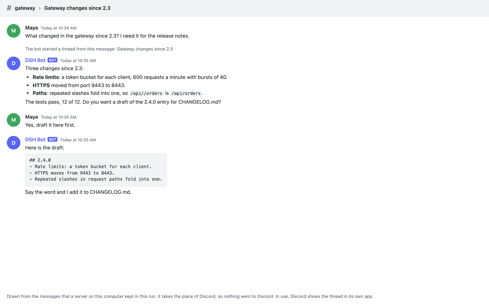
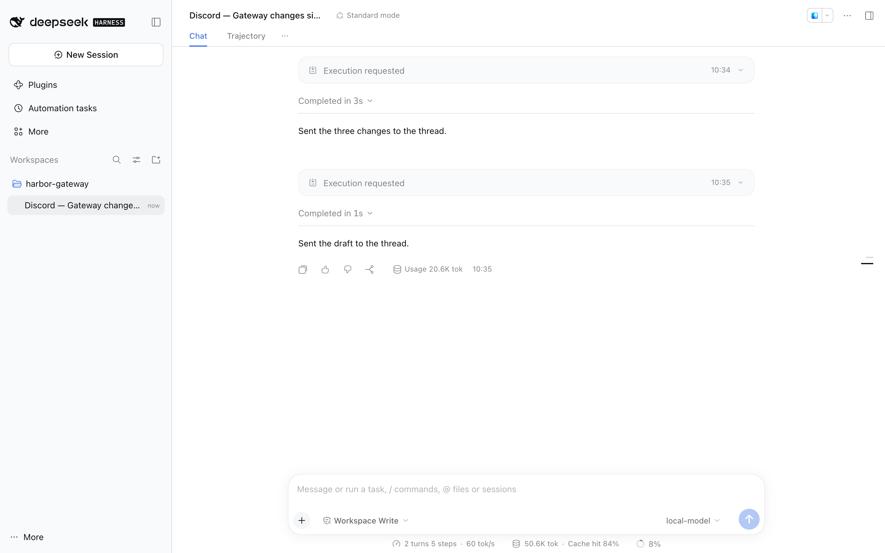

# dsh-plugin-discord

A [DeepSeek Harness](https://github.com/deepseek-ai/deepseek-harness) (DSH)
plugin that is the bot behind your Discord channels: you talk to DSH agent
sessions from Discord.

<!-- showcase:hero -->

<!-- /showcase:hero -->

- A message in one of the bot's channels gets a **thread made from it**, and
  that thread gets **its own DSH session**. Every later message in the thread
  goes to the same session, also after DSH restarts.
- The agent answers **with the `discord_send` tool**. Its plain text output
  never reaches Discord, so the plugin makes sure every turn ends with an
  answer in the thread: a turn that forgets is reminded once, and if it still
  sends nothing, its last words are posted. A turn that fails says so.
- **Nothing is answered twice, and nothing goes unanswered without a word**:
  handled message ids are remembered, the gateway session is resumed after a
  drop, and after DSH was down the bot reads what was posted meanwhile and
  answers it. When it does not answer a message late (too old) or could not
  read all of them, it says so where they were posted.
- Slash commands in the thread: `/status`, `/stop`, `/new`, `/reset`,
  `/rename`, `/model`, `/effort`.

It needs nothing beyond DSH: the Discord REST and gateway client is written
on Node 22's `fetch` and `WebSocket`.

<!-- showcase:screenshots -->
## Screenshots



*The same drawn thread in light mode.*



*DSH's side: the thread has a session of its own, which you can open and read. Each Discord message comes in as an Execution requested row; open one to read it.*

Made by `npm run showcase` in a demo home; [docs/site.json](../../docs/site.json) lists them, with their words.
<!-- /showcase:screenshots -->

## Setup

1. Create an application and a bot at
   <https://discord.com/developers/applications> and switch on the **Message
   Content Intent** (Bot → Privileged Gateway Intents). Without it Discord
   closes the connection (code 4014) and the bot says so in its log.
2. Invite the bot with the scopes `bot` and `applications.commands` (the
   second makes the slash commands appear):

   ```
   https://discord.com/oauth2/authorize?client_id=<APPLICATION_ID>&scope=bot+applications.commands&permissions=326417632320
   ```

   The number asks for exactly these permissions, and nothing more:

   | Permission | What the bot does with it |
   |---|---|
   | View Channels | sees its channels and their threads |
   | Read Message History | reads what was posted while DSH was not running |
   | Send Messages | answers in a channel (a line about a message it could not take) |
   | Send Messages in Threads | answers in the threads |
   | Create Public Threads | opens a thread for each new message, and `discord_create_thread` |
   | Manage Threads | names threads, also ones people opened by hand, and opens an archived one again |
   | Embed Links | shows previews of the links it sends |
   | Attach Files | `discord_send_file` |
   | Add Reactions | `discord_react` |

3. Store the bot token in DSH's credential store, `.credentials.yaml` in
   DSH's data folder (`~/.dsh`, or `$DSH_HOME`), owner-only:

   ```yaml
   version: 1
   refs:
     DISCORD_BOT_TOKEN: <your token>
   ```

   An environment variable of the same name works too, and so does another
   name if `tokenRef` says it.
4. Add the plugin to your profile (its own bundle adds the row `discord`,
   with the defaults). Then, in the profile's `cordis.patch.yml`, give that
   row a workspace (the absolute path of a folder that exists), your
   channel and your user id (in Discord: Settings →
   Advanced → Developer Mode, then right-click → Copy ID). **Ids go in
   quotes**: YAML rounds long numbers, so an unquoted id could never match,
   and the bot refuses to start with one.

   ```sh
   dsh plugin --profile desktop add ./dsh-plugin-discord
   ```

   ```yaml
   - id: discord
     config:
       workspacePath: /path/where/discord/agents/work
       allowedChannelIds: ["<channel id>"]
       allowedUserIds: ["<your user id>"]
   ```

5. Save the profile. A running DSH applies the changed row by itself (its
   profile hot reload); one without hot reload applies it at its next start.
   `discord: gateway connected; listening for messages` in the plugin's log
   says the bot is up. Every problem is said there too, in one line, with
   what to do. The plugin logs through DSH's logger, which keeps plugin lines
   in memory, and writes each line to its trace file as well, where you can
   read them back: `grep '"event":"log"' ~/.dsh/discord-plugin-trace.log`.

## Settings

The settings are the `config:` of the plugin's row in your profile (step 4
above). DSH's Plugins page lists the plugin as **Discord**, with its icon and
one sentence, and shows whether it runs, but it has no form for these settings (DSH draws one only for plugins that bring
a part of the window, and this one runs in DSH's host only), so you change
them in the row.

Every setting can be left out. A wrong value never stops the plugin from
loading: it falls back to its default, with a line in the plugin's log naming the
setting, the value and the default. The two allowlists are the exception: a
wrong one keeps the bot **offline** (it never falls back to answering
everyone).

| Setting | Type | Default | What it does |
|---|---|---|---|
| `enabled` | boolean | `true` | `false` keeps the plugin loaded with the bot offline and no Discord tools. |
| `tokenRef` | string | `"DISCORD_BOT_TOKEN"` | The credential name that holds the bot token, in DSH's credential store or the environment. |
| `workspacePath` | string (absolute path) | `""` | The folder the Discord sessions work in, and the only folder `discord_send_file` uploads from. It must be the absolute path of a folder that exists: empty, relative, missing or not a folder, the bot stays offline and the log says which. |
| `agentPreset` | string | `"standard"` | The agent preset for the sessions the bot starts. |
| `permissionPreset` | string | `"workspace-write"` | The permission preset for those sessions: `read-only`, `workspace-write` or `danger-full-access`. See [Safety](#safety). |
| `allowedChannelIds` | list of id strings | `[]` | Channel ids (in quotes) the bot answers in, and their threads. Empty: it answers nowhere (and says so at start). |
| `allowedUserIds` | list of id strings | `[]` | User ids (in quotes) the bot answers. Empty: anyone who can post in the allowed channels (said at start). |
| `requireMention` | boolean | `false` | `true`: a message in a channel must @mention the bot to start a thread. Messages inside a thread never need one. |
| `autoThread` | boolean | `true` | `true`: each message in a channel gets its own thread and session. `false`: the channel itself is one session. |
| `threadArchiveMinutes` | number | `1440` | Discord's auto-archive time for new threads: `60`, `1440`, `4320` or `10080`. |
| `titleModel` | string | `""` | The model that names threads (`"provider:model"` or a model id). Empty: DSH's default model. |
| `titleTimeoutMs` | number (ms) | `20000` | How long the title model may take, in ms (1000 to 300000). After that the title comes from the message's own words. |
| `models` | list of strings | `[]` | Model choices `/model` lists (`"provider:model"`). Any model can still be typed. |
| `maxPromptChars` | number | `8000` | The longest relayed message, in characters (500 to 200000). Longer text is cut with a note; the reply instruction is always kept whole. |
| `requestTimeoutMs` | number (ms) | `15000` | How long one Discord call may take, in ms (1000 to 120000). |
| `replyFallback` | boolean | `true` | `true`: a turn that ends without a Discord reply is reminded once, then its last words are posted. |
| `postErrors` | boolean | `true` | `true`: a failed turn says so in its thread. |
| `catchUpMinutes` | number (minutes) | `120` | After DSH or its connection was down, the bot answers a message posted in the last this-many minutes. An older one is not answered, and its thread (or, in a channel, the message itself) is told so. `0`: no message is answered late, and each is told. |
| `sendScope` | `"allowed"` or `"any"` | `"allowed"` | `"allowed"`: every Discord tool that acts in a channel (send, file, typing, new thread, reaction) acts only in the allowed channels, their threads and `extraSendChannelIds`. `"any"`: anywhere the bot can. |
| `extraSendChannelIds` | list of id strings | `[]` | More channel ids (in quotes) the tools may post in, with `sendScope: "allowed"`. |
| `apiBase` | string (URL) | `""` | Discord's REST address; empty means Discord itself (`https://discord.com/api/v10`). The gateway address comes from it, so the tests point it at a fake Discord on this computer. |
| `traceFile` | string (path) | `"~/.dsh/discord-plugin-trace.log"` | The bot's event trace, one JSON line per event, owner-only, with every line the plugin logs (`"event":"log"`). Each start keeps the previous run as `.1`; a run stops writing at 20 MB. `""`: off. |
| `storeFile` | string (path) | `"~/.dsh/discord-plugin-sessions.json"` | Which thread belongs to which session, the per-thread `/model` and `/effort`, the handled message ids, and a message taken but not yet handed to an agent. Owner-only. |

Paths that start with `~/.dsh/` follow `DSH_HOME` when DSH runs with one.

## How it behaves

- **Who it answers.** Only people in `allowedUserIds`, only in
  `allowedChannelIds` and threads under them. A thread is the bot's only
  while its channel is on that list: take a channel off, and its threads are
  no longer answered, and the tools and slash commands refuse them. Other
  bots and itself are never answered, and neither are Discord's own lines
  (someone started a thread, pinned a message, joined). Direct messages are
  not handled (the trace says so). Slash commands follow the same two lists:
  anyone else gets a private "This bot answers only the people it is set up
  for."
- **Threads.** A message in an allowed channel gets a public thread made from
  it, first named after the message. If Discord refuses the thread twice, the
  bot answers the message once in the channel, saying why; it posts nothing
  else in the channel. Posting in an archived thread opens it again and goes
  on with the same session.
- **One session per thread.** The DSH session is listed in DSH's window as
  "Discord — <thread name>", and after `/new` as "Discord — <thread name>
  (session 2)" (then 3, 4 ...), so two sessions never share a name. Its Chat
  tab shows the agent's turns (tool calls and words). The relayed Discord messages are context rows, which DSH leaves
  out of Chat (as it does for every message not typed in its window) and
  shows in the session's Trajectory tab. Messages that arrive while the
  agent works are queued for its next turn; threads run side by side. A
  thread's work runs one step at a time, so two quick messages can never
  open two sessions.
- **What the agent is told.** Each message reaches the session with who sent
  it (username, display name, id), the thread, any attached files (name, type,
  size and address) and how to reply (`discord_send` with this thread's
  channel id).
- **Never silent.** A turn that ends without `discord_send` is reminded once;
  if it still sends nothing, its last words are posted (or a line saying it
  finished without a reply). A failed turn posts "The agent's turn failed:
  <why>" with how to retry. Both are on by default (`replyFallback`,
  `postErrors`) and both show in the trace. What Discord or the model said
  is given in plain words, without request lines or status codes. A turn
  waiting for an approval in DSH says so in the thread, and what it waits to
  do (run a command, change files, read files, open a web page), never a
  tool's name (see [Safety](#safety)).
- **Names.** After the first reply, the title model names the thread and the
  session (cleaned: no quotes, Markdown, JSON or echoes of the prompt; at
  most 100 characters; unique, with `#2`, `#3`). A thread you renamed keeps
  your name, and the session takes it.
- **Restarts and drops.** The gateway session is resumed after a drop, with
  the events Discord kept. When Discord starts a fresh one instead (after a
  restart, or a long drop), the bot catches up: it reads every thread it
  keeps under an allowed channel (also one cleared with `/new`, and however
  long it was idle), every allowed channel (from the bot's first start
  there), and any thread someone opened by hand in one meanwhile, each from
  where the bot left off (the last message it handled or read there), 100 at
  a time, up to the newest one. It answers what it finds, telling the agent
  the message was sent while DSH was not running. Handled message ids (the
  last 1000) are kept in the store, so nothing is answered twice, and a
  message is never skipped just because the bot posted after it.
  - A message older than `catchUpMinutes` is not answered: the thread gets
    one line naming it (or how many there were), and a message in a channel
    gets a reply saying so.
  - A read that fails because Discord or the network is down is tried again
    three times, a minute apart. What still cannot be read (or more than
    2000 messages in one place) gets a line saying that some messages were
    not answered.
  - If DSH stopped while the agent was still working on a message (a crash,
    a quit mid-turn), or in the seconds after the bot took a message and
    before an agent had it, the thread is told so once after the restart, so
    nobody waits on an answer that is not coming.

  A rejected token or a missing intent stops the bot with a line saying
  which; anything else is retried with backoff (at most a minute between
  tries).
- **Replies.** Long text is split at 2000 characters on paragraph or code
  fence boundaries, never inside a code block. Mentions ping users only, never
  `@everyone`, `@here` or roles. Discord's rate limits are waited out.
  Typing shows while a turn runs (at most 30 minutes).

### Slash commands

| Command | What it does |
|---|---|
| `/status` | Privately: the thread's session (idle or working), its name in DSH and the folder it works in, its model and effort, and since when the bot is connected (in each reader's own time zone). |
| `/stop` | Stops the running turn; messages sent after it still run next. |
| `/new`, `/reset` | Clears this thread's session: the next message starts a fresh one, listed in DSH as "… (session 2)". The old session stays in DSH under its own name, without the Discord tools. |
| `/rename [title]` | Renames the thread and its session; without a title, the title model makes one. |
| `/model [spec]` | Shows, or switches, this thread's model from the next turn (`provider:model` or a model id); `/model default` goes back to DSH's default model. Either holds also when the session was opened in DSH's window first, over the model DSH picked there. `/new` clears it. |
| `/effort [level]` | Shows, or sets, this thread's reasoning effort (the model decides which levels it takes); `clear` goes back to the default. |

The commands are registered at start; a changed one is updated.

### Tools the agent gets

Only the sessions the bot runs for Discord get these tools: the session of
each Discord thread (or of a channel with `autoThread: false`). They are
registered in that session's own scope when the bot starts or resumes it,
or picks it up when DSH already has it open, and they leave it when the
plugin is unloaded or switched off. No other DSH session has them: a
session you start in DSH's window, or one another plugin starts, is offered
no Discord tool.

| Tool | What it does |
|---|---|
| `discord_send(channel_id, content, reply_to?, silent?)` | Sends a message (Markdown, split at 2000 characters). |
| `discord_send_file(channel_id, path, caption?)` | Uploads a file from inside `workspacePath` (at most 10 MiB). Links and `..` are resolved first; a file that then lies outside the folder, or that has other names (hard links), is refused. |
| `discord_typing(channel_id)` | Shows typing for about 10 seconds. |
| `discord_create_thread(channel_id, name, message_id?)` | Opens a thread and returns its id. |
| `discord_react(channel_id, message_id, emoji)` | Reacts with a unicode emoji, or a custom one as `name:id`. Anything else is refused before any request. |
| `discord_user(user_id)` | Looks up a user's public name. |

Every id a tool takes (`channel_id`, `message_id`, `reply_to`, `user_id`)
must be a Discord id, 17 to 20 digits, and is checked before any request is
made; every part of a request's path is encoded. A reaction or a new thread
is made in the channel the call names, so it is held to the same channels as
a send. With `sendScope: "allowed"` (the default) that is the bot's own
channels, their threads and `extraSendChannelIds`.

They answer in words: the send tools with `delivered to Discord (message
<id>)`, and any tool that could not do its job with `discord: not sent,
<why>` (offline and why, an id that is not a Discord id, a channel outside
the bot's own, a file outside the workspace folder, an empty message, what
Discord said).

## Safety

- Discord is input from outside. The bot answers only `allowedUserIds` in
  `allowedChannelIds`; set both. A wrong id keeps it offline.
- The sessions it starts use `permissionPreset`, by default
  `workspace-write`: they can write in `workspacePath`, and anything wider
  asks for approval in DSH's window (with no window open, DSH refuses at
  once). Nobody on Discord can approve: when a turn has waited 3 seconds for
  an approval, the thread says what it waits for and in which DSH session,
  and the turn goes on once you answer in DSH. `danger-full-access` never
  asks; use it only for a bot that answers only you, in a workspace you can
  lose.
- The Discord tools exist only in the bot's own Discord sessions (see
  "Tools the agent gets"). `discord_send_file` reads only files inside
  `workspacePath`, after resolving links and `..`, never a file with other
  hard links, at most 10 MiB, and through the one open handle it checked.
  Every id a tool takes is checked as a Discord id before it is used.
- The token is read through DSH's credential store and never written to the
  trace, the store, the log or a message. The trace and the store are
  owner-only.
- To switch the bot off, set `enabled: false` in its row and save the
  profile: the plugin stays loaded, with the bot offline and no Discord
  tools. To go back to an earlier build, put that build back in the plugin
  folder and restart DSH: the store keeps its version-1 shape, so an earlier
  build still reads it (it ignores the fields it does not know). Coming back
  to this build after one is safe too: an earlier build does not keep the
  handled ids, so for a store it wrote last, catch-up takes a message the bot
  replied after as answered.

## Tests

Nothing in the tests reaches the real Discord or reads a real token. They run
against a fake Discord (`test/support/fake-discord.mjs`): a REST server and a
gateway on 127.0.0.1 that speak Discord's API v10 (hello, identify,
heartbeat, resume with replay, reconnect, invalid session, close codes, rate
limits) and accept only a made-up token.

```sh
npm test               # unit tests, a few seconds
npm run e2e            # the plugin on every real DSH build found, end to end
npm run e2e:install    # once: the DSH test builds, into .e2e/
```

**Unit tests** (`test/unit/`, Node's test runner) cover the settings, paths,
store, trace, titles and splitter; the client against the fake Discord
(retries, backoff, resume, fatal close codes, heartbeats, rate limits,
errors in words); the router with a fake DSH host (gates, threads,
sessions, queues, catch-up, never silent, slash commands, attachments,
renames); and the plugin loaded with DSH's own packages (its settings
schema, its tools through DSH's `defineTool`, start and unload, `/model` over
the model choice DSH puts on a session it opens, and its title, sentence and
icon as DSH's Plugins page reads them). They need
DSH's packages: `test/support/dsh-modules.mjs` finds them in `DSH_MODULES`,
or in a test build (`.e2e/dsh-*` from `npm run e2e:install`, the same under
`DSH_E2E_DIR`, or the plugin suite's `.e2e/`).

**End to end** (`test/e2e/run.mjs`): a real DSH in a throwaway home, with
this folder linked into its profile, a scripted model on this computer
(`test/e2e/fake-model.mjs`) and the plugin pointed at the fake Discord
(`apiBase`). DSH gets no `DISCORD_*` variable; the plugin's token is a
made-up one in a variable of its own. The run goes through what the person on
Discord sees (its top comment lists every step) and checks the session's own
log on disk. It also restarts DSH and types in the Discord session in DSH
first (the bot picks that session up, and `/model` and `/new` hold there),
switches the bot off and on by editing its row while DSH runs, and checks the
plugin's title, sentence and icon in DSH's plugin list. `npm run e2e` (`scripts/e2e.mjs`) runs it on every DSH build it
finds: the test builds (`.e2e/`, `DSH_E2E_DIR`, or the plugin suite's
`.e2e/`) and the installed app's own DSH, which runs as a separate process
in its own throwaway home. `npm run e2e -- --dsh 0.2.1-rc.1` runs one build.
With `SHOTS=<folder>` it also takes pictures, light and dark, of DSH's
window (the Discord session's Chat tab, also 760 px wide, and its
Trajectory tab with the relayed messages; the plugin in DSH's Plugins page,
installed and running, also 760 px wide) and of the fake Discord's thread
as a person would read it. A build takes about two minutes.
`KEEP=1` keeps the throwaway folders.

## Files

```
lib/index.js     the plugin: settings schema, start, tools, unload
lib/config.js    reads the settings; a wrong value is said in words
lib/client.js    Discord REST and gateway (resume, backoff, rate limits)
lib/router.js    gates, threads, sessions, never silent, catch-up, slash commands
lib/store.js     thread → session store and handled ids (owner-only JSON)
lib/tools.js     the six tools the agent gets
lib/llm.js       the title model call
lib/titles.js    title cleaning, fallback, uniqueness
lib/split.js     the 2000-character splitter
lib/trace.js     the event trace
lib/paths.js     ~/.dsh paths that follow DSH_HOME
locale/en.json   the plugin's title and sentence in DSH
icon.svg         its icon in DSH (36 by 36)
test/unit/       unit tests (npm test)
test/support/    the fake Discord, a fake DSH host, DSH's packages, temp folders
test/e2e/        the real-DSH run, its bench and its scripted model
scripts/         npm run e2e, npm run e2e:install
```

## License

[MIT](LICENSE)
