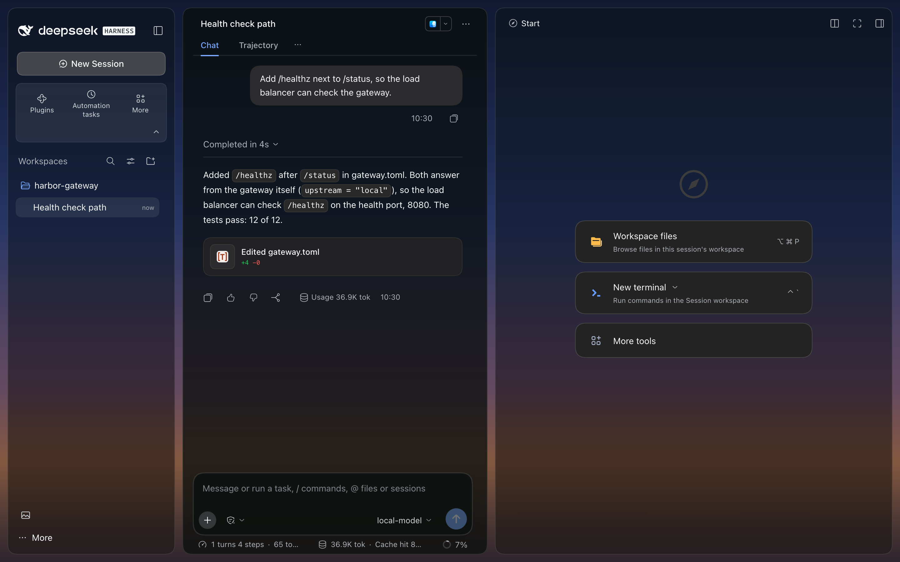
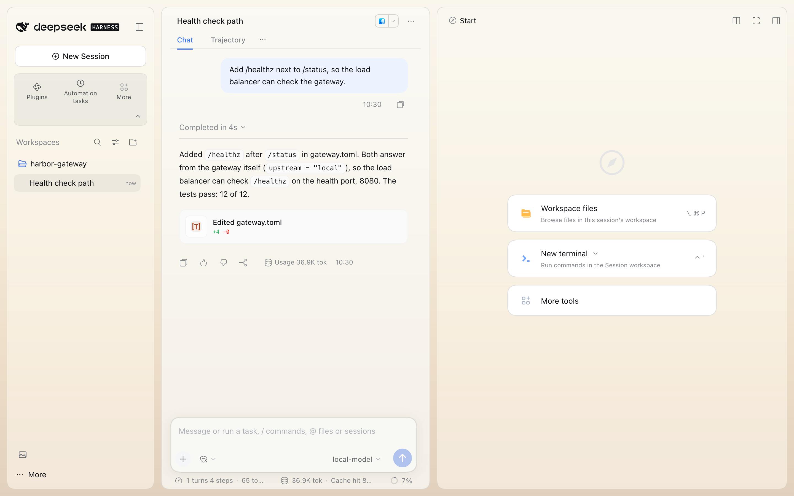
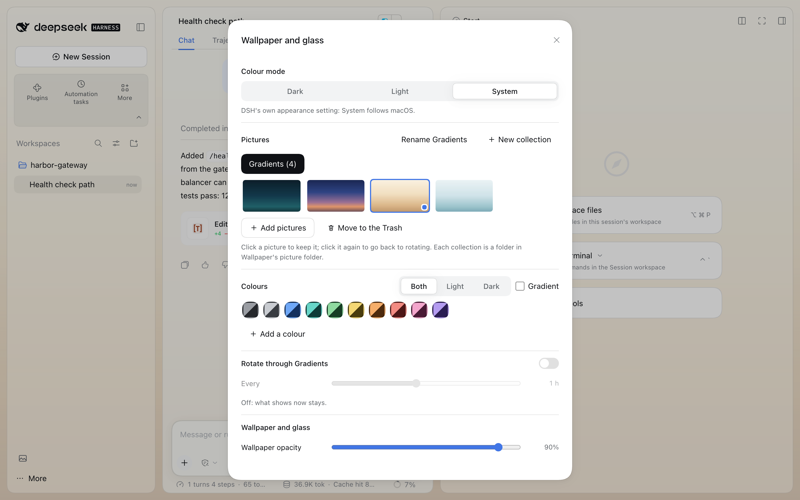
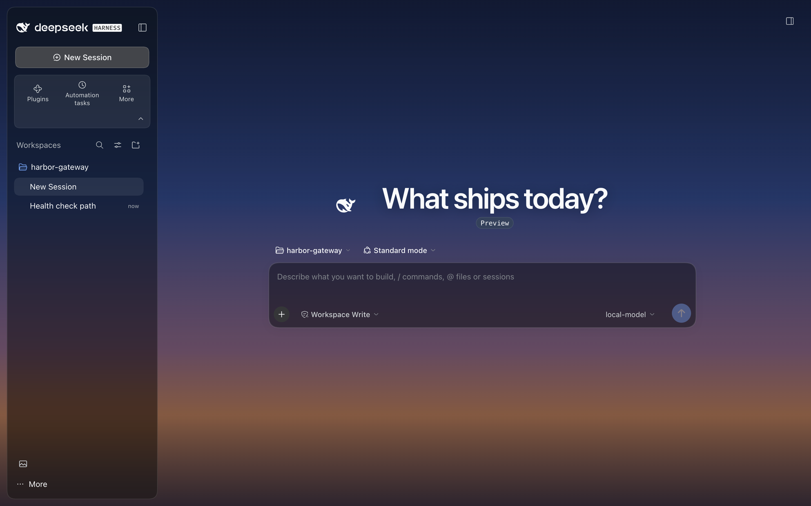

# Wallpaper

Wallpaper and glass for DeepSeek Harness Desktop. A picture or a colour sits behind DSH, and DSH's sidebar, open
chat, right dock and composer become frosted glass over it. An optional headline replaces DSH's words on the
new-chat page. Everything is set in one panel, opened from a button in the sidebar footer.

<!-- showcase:hero -->

<!-- /showcase:hero -->

Wallpaper is DSH's one mod ([DESIGN.md](../../DESIGN.md)): it changes DSH's grounds, never DSH's text, icons or
controls. The sidebar, the open chat and the dock become glass cards set 12px in from the window's edges, and the
composer a glass card. Its one other layout change is DSH's panel list shown as tiles, which fold to a row of icons.

<!-- showcase:screenshots -->
## Screenshots



*Light mode, over a generated sand gradient.*



*One panel for all of it: colour mode, pictures, colours, rotation and opacity.*



*An optional headline in place of DSH's words on the new-chat page.*

Made by `npm run showcase` in a demo home; [docs/site.json](../../docs/site.json) lists them, with their words.
<!-- /showcase:screenshots -->

## What it does

- **The wall.** Pictures from your collections, with a 1.1 s crossfade, or a colour: ten presets with a light and a
  dark tone, your own colours, a Gradient switch, and Both / Light / Dark to set the two modes apart. A colour takes
  the tone of DSH's colour mode.
- **Rotation.** Every 1, 5, 15 or 30 min, or 1, 2, 4, 8, 12 or 24 h, through the collection's pictures or through
  the colours. Click a picture to keep it; click it again, or switch Rotate on, to go back to rotating. Choosing a
  collection rotates through it, even after a colour switched rotation off.
- **Glass.** Four of DSH's surfaces become frosted cards. The grounds are dark (`rgb(14 18 17)`) or light (`rgb(250
  250 246)`) with DSH's colour mode:

  | Surface | Opacity | Blur | Corners |
  | --- | --- | --- | --- |
  | The sidebar (and DSH's narrow rail) | the tint | the blur, saturated | 18px |
  | The open chat (the new-chat page stays on the wall) | tint + .2 | the blur | 18px |
  | The right dock, while it is open | the tint | the blur, saturated | 18px |
  | The composer, with DSH's accent on its line while you type | the tint | the blur, saturated | 22px |

  Sliders set the wallpaper's opacity (0 to 100%) and frost (0 to 24px), and the glass blur (0 to 40px) and tint (10
  to 95%). In an open chat nothing paints between the glass composer and the chat card: DSH's fade behind the
  composer goes on glass, as the session list's bottom fade does.
- **DSH's words stay readable over any picture.** DSH's text colours are made for its own grounds. When the picture
  fights the colour mode (a dark picture in light mode, a light one in dark), a veil in the mode's own ground lies
  over the picture, just thick enough that, at the tint in use, each of DSH's text colours keeps 4.5:1 on the glass
  and on a selected row (or 80% of what DSH gives it on its own ground, where that is less: DSH's tertiary grey is
  3.7:1 on its own white), and DSH's main text 4.5:1 on the bare wall (the new-chat page). A picture that fits the
  mode gets none. Wallpaper works it out from the picture itself, drawn at 24 × 16, once a picture, for each mode,
  and the veil fades with the picture. A higher tint needs less veil, down to what the words on the bare wall need.
  At the default 55% tint over a dark blue picture, the veil is .81 in light mode and none in dark; over a sand
  picture, .18 in light and .51 in dark.
- **Reduce transparency.** With the system's Reduce transparency on, the glass goes near-opaque: at least 90%, and
  the open chat at least 95%. A higher tint still applies.
- **Motion.** Off stops the wallpaper's crossfade and every transition on the page (DSH's and other plugins', their
  `::before` and `::after` too), and tells other plugins to stop theirs (`body.wp-still`). DSH's own animations,
  such as a turn's progress, keep running. The system's Reduce motion always stops Wallpaper's own motion.
- **Headline.** Your own words, up to 120 characters, on the new-chat page in place of DSH's, in DSH's font. Empty,
  the default, shows DSH's own.
- **Colour mode.** Dark, Light or System (System follows macOS). It is DSH's own appearance setting, written only
  when you pick one.
- **Panel tiles.** DSH's panel list (Plugins, Automation tasks and every plugin's page) shows as tiles, three to a
  row. Every entry stays, in DSH's order. The arrow at the tiles' lower right folds them to one row of icons and
  back; the choice is kept in the window's storage (`dsh-plugin-wallpaper/tiles-folded`), so it holds across
  reloads. Folded, the names are hidden: screen readers still hear each one, but DSH shows no tooltip there, so
  unfold to read them. In DSH's rail of icons (a window under 1024px) they stay one column, with no fold.
- **The library.** Each collection is a folder in Wallpaper's picture folder, and only pictures in those folders are
  shown. Add pictures (JPEG, PNG, WebP or HEIC, up to 60 MB; big photos are scaled to 3840px before they are sent)
  with Add pictures or by dropping them on the list. A file is taken by its first bytes, not its name: a text file
  named `.jpg` is refused in words. Make or rename a collection: a name starts with a letter or a number in any
  script (Café, 写真), then letters, numbers, spaces and `- _ . , ' ( ) + &`, up to 80; a change of case only works
  too. Folders in the picture folder that can't be a collection, and pictures outside any collection, are named under
  the pictures with the reason. Move to the Trash asks first and moves the picture shown now into your macOS Trash.
  The window gets each picture at 2880px as JPEG, made once with macOS's `sips` and kept in `wp-cache/`.
- **A file that can't be shown.** A file put in a collection's folder by hand that the window can't read as a
  picture is marked "Can't be shown" on its tile, passed over by rotation (the wall moves on to the next picture),
  and named under the pictures with a Move to the Trash button of its own. The host tries to resize it once and
  writes one line to `wallpaper.log`; it tries again only when the file changes. A picture's address carries its
  file's modified time, so a file fixed or replaced in the folder under the same name shows the next time the panel
  opens.

## The panel

The picture button in the sidebar footer opens it, in DSH's own dialog. Escape or the close button closes it, and
the focus goes back to the button.

- Each section has a heading. DSH's own parts do the work: a segmented control for the colour mode, switches for
  Rotate and Motion, a tick box for Gradient, DSH's buttons.
- The pictures and the colours are one tab stop each; the arrow keys, Home and End move inside, and Enter or Space
  picks. The picture on the wall has an accent border, a kept one a dot, and screen readers hear "kept".
- New collection and Rename open a name field with the focus in it. Enter saves the name, Escape leaves it as it
  was, and either puts the focus back on the button that opened the field. Enter in the headline saves it and keeps
  the focus there.
- The question before Move to the Trash opens on Cancel, and Escape means no.
- A change shows at once and is saved in the background; a slider's run is saved once, when it stops. When a save
  fails, the section you are in says so in plain words ("Couldn't save: …"), and the panel goes back to what is
  saved; the next save that works clears the note.
- Removing your own colour while it is on the wall puts Graphite in its place, and the panel says so.
- When the config row has a problem (an unknown key, a value of the wrong kind), a line at the top of the panel
  names it; `wallpaper.log` has each one.
- When Wallpaper's host half can't be reached, the panel says so at the top. At start, Wallpaper asks four times
  over 12 seconds, then says so in DSH's banner at the top of the window and shows its defaults.

## For other plugins

Wallpaper publishes these on `<body>`. Read them, with a fallback, and never write them:

| What | Meaning | Read it as |
| --- | --- | --- |
| `--wp-blur` | the glass blur, `0px` to `40px` | `var(--wp-blur,22px)` |
| `--wp-tint` | the glass opacity, `0.1` to `0.95` | `var(--wp-tint,.55)` |
| class `wp-still` | Motion is off: stop your animations and transitions | `body.wp-still …` |
| class `wp-on` | Wallpaper is on (rarely needed) | `body.wp-on …` |

Fleet, for example, uses `background: rgba(14,18,17,var(--wp-tint,.55))` and `backdrop-filter:
blur(var(--wp-blur,22px))` on its cards, so they follow the sliders with Wallpaper on and use their own defaults
with it off. Nothing else of Wallpaper's is a contract: the wall's own values (`--wp-op`, `--wp-frost` on
`#wp-wall`, `--wp-headline`) and its class names may change.

## Config

Row `wallpaper` in the profile's `cordis.patch.yml`. Every key is optional:

| Key | Type | Default | Effect |
| --- | --- | --- | --- |
| `dataDir` | folder path (absolute or `~/…`) | `<DSH home>/wallpaper` | Where `state.json` (the settings), `wp-cache/` (resized pictures) and `wallpaper.log` live. If it can't be made, the default is used and the log says so. |
| `wallpaperDir` | folder path, or `null` | `null`: `<dataDir>/wallpapers` | The picture library: one folder per collection. |
| `importFrom` | folder path, or `null` or `false` for no import | `<DSH home>/fleet-shell` | Read once, on the first start (below). |

```yaml
- id: wallpaper
  name: dsh-plugin-wallpaper
  config:
    wallpaperDir: ~/Pictures/Wallpapers
    importFrom: false
```

`<DSH home>` is `$DSH_HOME`, or `~/.dsh` when it is not set, so a test DSH keeps its own copy. A value of the wrong
kind (a number, a relative path) or an unknown key is ignored with a line in `wallpaper.log` and a line at the top
of the panel, and the default is used: the plugin always loads. When no folder can be written at all, the panel
says so and nothing is saved. The row declares no schema: `dsh-test doctor` shows the row's keys as written but
doesn't check them, so Wallpaper checks each one itself.

**First start.** When `<dataDir>/state.json` does not exist yet, Wallpaper copies Fleet Shell's look settings
(headline, wallpaper, colours, rotation, glass, motion) from `importFrom/state.json`, and its pictures from
`importFrom/wallpapers/` (APFS clones, so no extra disk until a file changes). Values that don't fit are left out,
with a line in the log. Nothing else is read, and the originals stay, so going back to Fleet Shell loses nothing. It
never imports again.

**Settings.** The panel keeps them in `state.json`:

| Setting | Type and range | Default |
| --- | --- | --- |
| `headline` | text, one line, up to 120 characters | empty (DSH's own words) |
| `wallpaperKind` | `"image"` or `"colour"` | pictures |
| `wallpaperCollection` | a collection's name | `"cars"` (then the first collection with pictures) |
| `wallpaperPinned` | a picture's file name, or `null` | `null` (rotating) |
| `wallpaperRotate`, `wallpaperRotateMin` | `null` or `"off"`; 1, 5, 15, 30, 60, 120, 240, 480, 720 or 1440 minutes | rotating every 60 minutes |
| `wallpaperOpacity`, `wallpaperFrost` | 0 to 100 (%); 0 to 24 (px) | 90; 4 |
| `glassBlur`, `glassTint` | 0 to 40 (px); 10 to 95 (%) | 22; 55 |
| `motion`, `wallpaperGradient` | `true` or `false` | `true`; `false` |
| `wallpaperColour`, `wallpaperColours` | `{ light, dark }` as `#rrggbb`; up to 16 of your own colours | Graphite; none |

A change is all or nothing: a value of the wrong kind, or a setting that isn't Wallpaper's, is refused in words and
nothing is saved (the route answers 400); a number out of its range is held to the range. A disk that won't take a
change is the host's fault, not the sender's: the route answers 500, in words. Every change and refusal is written
to `wallpaper.log`. A `state.json` that can't be read is kept as `state.json.unreadable-<time>`, and the defaults are
used.

## Switch it off, remove it, roll back

- **Off:** switch it off on DSH's Plugins page, or add `disabled: true` to its row. DSH applies it live: the wall,
  the style sheet, the classes and values on `<body>`, the footer button and the fold button all go, and DSH looks
  as it does without Wallpaper. On again, there is one of each, and nothing is imported again. Settings and pictures
  stay in `dataDir`.
- **Remove:** delete the row, or quit DSH and run `scripts/uninstall.sh wallpaper`. The data folder stays; it holds
  your picture library, so look before you delete `<DSH home>/wallpaper` yourself.
- **Roll back:** the plugin is code; going back is checking out the earlier commit in the checkout the live DSH
  loads and restarting DSH. `state.json` keeps the same keys, so the earlier version reads it as it is.

## Try it in DSH Test

```bash
dsh-test --name wp load plugins/wallpaper
dsh-test --name wp up && dsh-test --name wp doctor
```

Nothing else to load. A DSH Test home has no Fleet Shell folder, so Wallpaper starts with an empty library: make a
collection with New collection and add a few pictures. To try the first-start import, set `importFrom` to a folder
holding a `state.json` and `wallpapers/<collection>/` before the first start. DSH Test runs as you, so Move to the
Trash uses your own macOS Trash.

## Tests

```bash
node plugins/wallpaper/lib/impl.test.mjs     # host, offline, under a second
node plugins/wallpaper/test/unit.test.mjs    # client, offline, under a second
cd plugins/wallpaper && npm test             # both
node scripts/e2e.mjs wallpaper               # real DSH, every build, 1 to 2 minutes each
```

**Host** (`lib/impl.test.mjs`, 19 checks, in a temporary home it removes): the first-start import (look settings
checked, nothing else, originals kept, one time only); settings saved and logged; refusals (each kind of wrong
value, unknown keys, no body) with nothing saved; numbers held to their ranges; collections and pictures, with bad
names refused; resized pictures, two pictures with one name each their own, nothing outside the library served; the
Trash (the kept picture let go, the cached copy dropped), across disks, and a Trash that can't be written (500); a
text file named `.jpg` refused by its bytes, and each picture kind taken by its bytes (a HEIC without a picture
type too); a file `sips` can't read served as it is and logged once until it changes; a settings file that can't be
written (500, in words, nothing kept) against a refused value (400); names in any script, a change of case only,
and folders left out named with the reason; an unreadable `state.json`; config values of the wrong kind, and the
panel told of each; a `dataDir` that can't be made; no folder at all.

**Client** (`test/unit.test.mjs`, 27 checks): the file loads as DSH loads it and never throws without DSH's parts;
the settings the look uses; rotation; what the wall shows for colours and pictures, and a picture that can't show
passed over (kept or not); the veil (none for a picture that fits the mode, enough for one that fights it, less at a
higher tint, and DSH's text colours at their bar on the glass at the veil it gives); the headline's escaping; the
style sheet against DESIGN.md (every rule on DSH anchored at an outlet and under `body.wp-on`, no hash, nothing on
`:root`, `html` or `body`, no other plugin's classes, nothing of DSH's hidden, DSH's tokens and font only, reduced
transparency on all four surfaces, motion with pseudo-elements); set-up and switch-off (one style sheet, one wall,
the published values, one MutationObserver, two slot entries, all removed, nothing doubled on again); the start-up
retries and toast; a refused save (the caller is told it was not kept); a save that works clearing the "Couldn't
save" note; the panel naming the config's problems, folders left out and a picture that can't be shown (its tile,
its note, its Trash button); a click on the kept picture rotating again after Rotate off, and choosing a collection
rotating through it; removing the colour on the wall putting Graphite in its place; a slider's run as one save;
README, manifest and locale; and no assistant or vendor names.

**Real DSH** (`test/e2e/run.mjs`, 97 checks a build): DSH runs in a throwaway home with a throwaway user home (its
own Trash), a Fleet Shell folder to import from, and a scripted model, with a stand-in neighbour plugin beside
Wallpaper (`test/e2e/neighbour/`: a panel entry, a page and a footer button); a Chromium works its window. It checks
the import on disk; the wall's picture and its route; the published values; each anchor finding exactly one of
DSH's surfaces and each surface's glass, opacity, blur and corners, in light and dark, with the dock closed and
open; the headline in DSH's font; the panel by keyboard (DSH's dialog, focus in and back); sliders and Motion
reaching `state.json`, `<body>` and the computed transitions; keeping a picture, the arrow keys, rotation, and
letting a kept picture go after Rotate off; adding a picture, a text file named `.jpg` refused, making and renaming
a collection (the focus into each name field and back to its button); the Trash question (Cancel first, Escape)
and the move; a file in a collection that isn't a picture (its tile marked, the wall moving on, one line in the
log, its own Trash button), and one fixed under the same name showing again; a colour in both tones; emptying the headline (Enter keeps the focus); refused values
on the route; a save the disk refuses (a 500, the note, cleared by the next save); **DSH's own words read from the
window's pixels** over a dark and a light picture at the default tint, in light and dark, on the new-chat page and
in an open chat with the dock (every run of DSH's text in the sidebar, the chat and the dock against the same run
with the look taken off: 4.5:1, 3:1 large, or 80% of DSH's own where that is less); nothing painted between the
glass composer and the chat card; a higher tint needing less veil; the neighbour's tile, page (its main words read
over the wall) and footer button; the style cost of the open chat's `:has()` while words are added to it; reduced
transparency; reduced motion; the panel's text contrast in light and dark; a 760px window; folding the tiles
across a reload; switching off and on live (the neighbour untouched); a restart; and no errors in the window,
DSH's log or `wallpaper.log`.

- **Builds:** the npm builds 0.2.0-rc.2 and 0.2.1-rc.1, and the DSH inside the installed app (0.2.1-rc.3), which
  runs as a separate process in its own throwaway home; the running app is never touched. `--dsh 0.2.1-rc.1` or
  `--dsh app` runs one.
- **Setup:** the runtimes are found in `<repo>/.e2e` (a link to `~/Projects/dsh-plugin-suite/.e2e` is fine), else
  `DSH_E2E_DIR`, else `~/Projects/dsh-plugin-suite/.e2e`; Playwright is `playwright-core` under `.e2e/tools` (or
  `PLAYWRIGHT_MODULE`). An npm build installs with `npm i --prefix .e2e/dsh-<version> @deepseek-ai/dsh@<version>`.
- **Pictures:** `.shots/wallpaper/<build>/` (`E2E_SHOTS=<dir>` elsewhere, `NO_SHOTS=1` for none), each in light
  and dark: the new-chat page, a chat with the dock, the panel, the Trash question, a colour wall with the panel,
  reduced transparency, reduced motion (with the panel), 760px with and without the panel, folded tiles, switched
  off, after a restart, DSH's words over a dark and a light picture (`readable-*`), the neighbour's page; and in
  light, a file that can't be shown and the composer over a dark picture. The pictures in this README come from a
  demo home (`npm run showcase -- wallpaper`) and are in [`docs/screenshots/wallpaper/`](../../docs/screenshots/wallpaper).
- **Safety:** the runner reads the live DSH's fingerprint (pid, start time, profile hash) before and after, and
  fails when it moved. `KEEP=1` keeps the throwaway folders.

## Limits

- DSH's own pages in `main` (its Plugins page) and other plugins' pages get no glass, so their text sits on the
  wall. The veil keeps DSH's main text at 4.5:1 there; its secondary grey can fall under: 4.26:1 on the neighbour's
  page in light mode over a dark picture (5.8:1 on DSH's own white). Holding every colour on the bare wall too would
  take the veil to .92 in light mode over a dark picture at any tint, so it doesn't. Whether those pages get glass is
  an open question in DESIGN.md.
- The veil trades picture for words. At the default 55% tint, a dark picture in light mode is veiled .81 and a light
  one in dark .51 (a picture that fits the mode, none). A higher tint needs less, down to what the new-chat page's
  words on the bare wall need (about .39 over a light picture in dark). DESIGN.md's open questions (DSH's labels
  deepened through its theme tokens, a tint floor) would let more of the picture show; they wait on the owner.
- The glass reaches DSH through its structure (a `data-slot` outlet, then the word in a class name). A DSH that
  changes that structure can lose the glass on a surface; the real-DSH test checks every surface on every build.
- Move to the Trash moves the file itself, so Finder's Put Back doesn't know where it came from: drag it back into
  the collection's folder to keep it after all.
- HEIC pictures are converted by macOS's `sips`; where it can't, the window gets the original.
- The open chat's card is found with one `:has()` (on the chat, never on DSH's session list). The look's cost while
  a chat streams is measured on every build by adding 120 words inside an open chat, 30 a second, each followed by a
  read of the chat card's style (a stand-in for a streaming reply, not a real model's), with the look and without
  it, three times each in turn: the check holds what the look adds to DSH's own style work under 1 ms a word, and
  the run prints both. Measured on the test Mac while about 20 other agents ran (load average 55 to 68): the look
  added 0.07 ms a word on 0.2.0-rc.2 (DSH alone 0.42 ms), 0.44 on 0.2.1-rc.1 (alone 2.2) and 0.90 on the app's
  0.2.1-rc.3 (alone 2.3), which is close to the bar there. Taking rules out in the page put a quarter to a third of
  it on the `:has()` and the rest on the rules that find DSH's parts by a word in a class name (with those out, the
  look adds nothing measurable).

## Files

- `lib/index.js`: tiny host entry that loads `impl.js` with a fresh URL on every enable.
- `lib/impl.js`: host side. Settings and their checks, the picture library and the first-start import; routes on
  `/api/wallpaper/*`.
- `lib/client.js`: the look, the panel and the tiles' fold, hand-written React (no build step). DSH hot-reloads it
  when it changes.
- `locale/en.json`, `icon.svg`: the name, description and icon on DSH's Plugins page.
- `cordis.patch.yml`: the profile row.
- `lib/impl.test.mjs`, `test/unit.test.mjs`, `test/e2e/run.mjs` (with `test/e2e/png.mjs`, which makes its pictures,
  `test/e2e/pixels.mjs`, which reads contrast from the window's pixels, and `test/e2e/neighbour/`, the stand-in
  neighbour plugin): the tests above.
